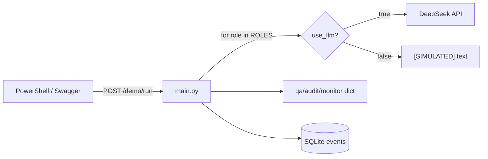

# Kiến trúc bản Demo (AS-IS có bằng chứng → TO-BE)

Phiên bản 1.1 — 05/11/2026 (thêm §1b sau Phase 3). Phiên bản 1.0 — 04/11/2026 (Phase 0). Mục tiêu TO-BE chi tiết: `DEMO_PLAN.md` mục 3–5. Trạng thái phase: `DEMO_PHASE_STATUS.md`.

## 1. AS-IS — những gì đang có trong code (04/11/2026)

| Thành phần | Thực tế | Bằng chứng |
|---|---|---|
| Ứng dụng | Một file `app/main.py` 126 dòng, FastAPI 0.115, uvicorn, httpx | đọc code |
| Container | `python:3.12-slim`, user không root, `cap_drop ALL`, `mem 1g`, healthcheck | `Dockerfile`, `compose.yaml` |
| Trạng thái container | đang chạy `healthy`, cổng `127.0.0.1:8088` | `docker compose ps` |
| DB | SQLite `/app/data/demo.sqlite` trên named volume `demo_data`; **1 bảng** `events(id, run_id, ts, actor, event, detail)` | `sqlite3` trong container: 127 event, 5 run |
| Endpoint | `GET /health`, `GET /agents`, `GET /sample`, `GET /events/{run_id}`, `POST /demo/run`, `/docs` Swagger | code + `curl /health` → `{"ok":true,...,"model":"deepseek-v4-flash"}` |
| `/dashboard` | **chưa có** | `curl` → 404 |
| 13 vai trò | danh sách `ROLES` 13 tuple (id, tên, mô tả) — chỉ là metadata | code |
| "Workflow" | vòng `for role in ROLES` chạy tuần tự, **không dependency, không trạng thái task, không retry, không cancel, không checkpoint** | code |
| Mock data | dict `SAMPLE` cố định trong code (LU-PH-001, 499/180/75/18, 15.000, DRAFT 4.000, 50, 100/20/15/2) | code, `GET /sample` |
| LLM | 1 hàm `ai()`: `max_tokens=1000`, timeout 60, không retry, response rỗng → trả chuỗi `[EMPTY RESPONSE…]` **nhưng task vẫn `task_completed`** (lỗi "rỗng mà báo thành công") | code |
| `use_llm` | **mặc định `True`** — trái quy tắc Mock Mode mặc định | `DemoRequest` |
| Mock Mode | chuỗi `[SIMULATED] {name}: processed synthetic inputs` giống nhau cho 13 agent — không có artifact | code, DB |
| QA/Audit/Monitor | 3 dict tính cứng cuối hàm: QA so `cost != 180`; Audit luôn PASS nếu `campaign.status == 'DRAFT'`; Monitor đếm `len(result)` | code |
| Error injection | chỉ `inject_error` → cost 9999 | code |
| Encoding | API trả UTF-8 đúng (`/sample`, DB). `result.json` ở thư mục cha có mojibake (`Trên dữ liá»u`) — file do PowerShell `Invoke-RestMethod | ConvertTo-Json` ghi, là lỗi hiển thị/ghi phía PowerShell, không phải dữ liệu gốc (xem M-04, cần test byte ở Phase 1 để xác nhận) | `curl`, `od -c` (`main.py` có BOM UTF-8, vô hại với Python) |
| Token usage / chi phí | không ghi | code |
| Test | **không có** thư mục `tests/` | `ls` |
| Tài liệu | `README.md` (hướng dẫn chạy, nói rõ không phải ARIS) | đọc |

### 1.1 Sơ đồ AS-IS



### 1.2 Khoảng cách so với DEMO_ONLY (tóm tắt, chi tiết theo R-nn ở `DEMO_PLAN.md` mục 2)

Thiếu toàn bộ: Workflow Engine có dependency/trạng thái (R-08), Agent Registry + artifact schema (R-01, R-09), Mock Business Environment + Mock API (R-06, R-07), 3 Engine thật và supervisor đọc engine (R-02), error injection 5 loại (R-11), dashboard (R-12), LLM client ổn định + token log (R-05), test (R-14), reset data (R-15). Có thể tái dùng: Dockerfile, compose, bảng `events`, dict `SAMPLE` làm hạt nhân fixture, hàm `log()`.

## 1b. AS-IS sau Phase 3 (05/11/2026)

| Thành phần | Thực tế | File |
|---|---|---|
| DB | `db.connect()` migrate idempotent: `events` (giữ dữ liệu cũ), `runs`, `tasks`, `artifacts`, `decision_log`, `llm_calls`, `approvals`, `engine_results`, `schema_version`=2; `db.tx()` commit + đóng kết nối | `app/db.py` |
| Mock data | Một nguồn duy nhất: `fixtures.json` (+ `conversations.json` khi có); `facts_for(inject)` cho bản sao theo run; `/sample` suy ra từ fixtures | `app/mock/data.py`, `router.py` |
| Đồ thị + máy trạng thái | Hàm thuần: `can_transition`, `topo_order`, `next_ready`, `to_skip`, `descendants`, `run_status`, `retry_plan`; 14 task (Commander plan + 12 vai trò + Commander summary) | `app/core/graph.py` |
| Workflow Engine | Tạo run + 14 task; chạy tuần tự theo topo order; agent sau nhận artifact của dependency; timeout theo task; agent lỗi/không trả artifact → FAILED; downstream → SKIPPED; retry đúng task, giữ artifact cũ; cancel; recover sau restart; replay đọc DB | `app/core/workflow.py` |
| Agent | Phase 3 dùng `placeholder` chứng minh bàn giao (`received_from`, `chain_depth`); Phase 4 thay bằng `HANDLERS` | `app/core/workflow.py` |
| API | `POST /runs` (`?wait=true`), `GET /runs`, `GET /runs/{id}`, `POST /runs/{id}/cancel`, `POST /runs/{id}/tasks/{task}/retry`, `GET /runs/{id}/decision-log`, `GET /runs/{id}/llm-calls` | `app/runs_api.py` |
| LLM client | Timeout, retry 429/5xx/timeout có backoff, rỗng → `LLMEmptyError`, `length` → WARN; ghi `llm_calls` cho **mọi** lượt kể cả lỗi | `app/llm/deepseek.py` |
| Legacy | `/demo/run`, `/events/{id}`, `/sample`, `/agents` giữ nguyên hành vi; `/demo/run` sẽ chuyển sang `/runs` ở Phase 4 | `app/main.py` |
| Agents (Phase 4) | `registry.py` 13 vai trò + quyền; `artifacts.py` 14 schema; `agents/business.py` + `supervisors.py` hàm thuần; `agents/narrate.py` Mock template / DeepSeek có hạn mức; `agents/__init__.handle` là điểm vào mặc định của workflow | `app/core/`, `app/agents/` |
| Engines + Gateway (Phase 5) | `engines/qa.py`, `audit.py`, `monitor.py` thuần; `core/gateway.py` hỏi Audit trước mọi hành động, ghi `decision_log`, giữ hành động vượt ngưỡng chờ duyệt; task giám sát dùng phụ thuộc mềm (`graph.SOFT`) | `app/engines/`, `app/core/gateway.py` |
| Dashboard (Phase 6) | `/dashboard` + `/static`: `main.js` (API, polling 1 s), `office3d.js` (three.js, CSS2D nhãn), `office-layout.js`, `office-props.js`, `panels.js`, `vendor/` three r160 | `app/web/` |
| Test | 435 test trong container, DB tạm riêng, key DeepSeek luôn rỗng khi test | `tests/` |

## 2. TO-BE — kiến trúc mục tiêu

Modular monolith FastAPI, một container, một SQLite. Cây thư mục và luồng run: `DEMO_PLAN.md` mục 3.

```mermaid
flowchart TB
  subgraph L1[Experience — văn phòng 3D three.js + chế độ 2D]
    D[Start Demo · 13 phòng agent · bong bóng · tài liệu bàn giao · QA/Audit/Monitor · Approve/Retry/Cancel/Replay]
  end
  subgraph L3[Orchestration — core/]
    C[Commander → task graph] --> W[Workflow Engine: state machine, retry, checkpoint]
    W --> G[Mock Tool Gateway — điểm "Act" duy nhất]
  end
  subgraph L2[Agents — agents/]
    A[13 agent: compute() Python → narrate() LLM/mock]
  end
  subgraph L6[Governance — engines/]
    QA[QA Engine] ; AU[Audit Engine] ; MO[Monitoring Engine]
  end
  subgraph L5[Integration — mock/]
    MA[/mock/* : market, ads, products, suppliers, campaigns, leads, orders, logistics, conversations, finance/]
  end
  subgraph L4[Data — SQLite]
    DB[(runs · tasks · artifacts · decision_log · llm_calls · approvals · engine_results · events)]
  end
  LLM[llm/deepseek.py | llm/mock_llm.py]
  D <-->|REST polling| W
  W --> A --> MA
  A --> LLM
  G --> AU
  W --> QA & MO
  W & A & G & QA & AU & MO --> DB
```

Nhãn L1–L6 ánh xạ tới 6 lớp Level Up OS chỉ để người xem demo liên hệ; không có n8n/BigQuery thật.

## 3. Ranh giới module (ai được import ai)

| Module | Được import | Không được import |
|---|---|---|
| `engines/*` | `db`, `core/registry`, `core/artifacts` | `llm/*`, `agents/*` (deterministic) |
| `agents/*` | `mock/api` (qua client nội bộ), `llm/*`, `core/artifacts`, `core/gateway` | `engines/*`, `db` trực tiếp (ghi qua workflow) |
| `core/gateway` | `core/registry`, `engines/audit`, `db` | `llm/*` |
| `llm/*` | `config`, `db` (ghi `llm_calls`) | mọi thứ khác |
| `web/` | chỉ gọi REST | — |

## 4. API mục tiêu

| Method | Path | Mục đích |
|---|---|---|
| POST | `/runs` | tạo run `{objective, mode: "mock"|"llm", inject: []}` |
| GET | `/runs` | lịch sử |
| GET | `/runs/{id}` | trạng thái run + tasks + artifacts + engine_results (replay, không gọi LLM) |
| POST | `/runs/{id}/cancel` | hủy |
| POST | `/runs/{id}/tasks/{agent_id}/retry` | retry đúng agent |
| POST | `/runs/{id}/approvals/{approval_id}` | `{decision: APPROVED|REJECTED}` |
| GET | `/runs/{id}/decision-log`, `/runs/{id}/llm-calls` | quan sát |
| GET | `/agents` | registry (giữ, mở rộng) |
| GET | `/mock/*` | Mock API |
| POST | `/admin/reset-demo` | Phase 9, cần `{confirm: true}` |
| GET | `/dashboard`, `/static/*` | HTML/JS tĩnh, three.js trong `vendor/` (`DEMO_DASHBOARD_3D.md`) |
| GET | `/health`, `/sample`, `/events/{run_id}`, `/demo/run` | giữ tương thích; `/demo/run` chuyển thành wrapper của `/runs` ở Phase 3 |

## 5. Yêu cầu phi chức năng (demo)

- Mock Mode: một run đủ 13 bước < 10 giây.
- LLM Mode: hạn mức `LLM_RUN_TOKEN_BUDGET` (mặc định 20.000 token/run), timeout 60 s/lượt, retry tối đa 3.
- Restart container không mất run đã ghi; task RUNNING lúc restart → FAILED "interrupted", retry được.
- Không bind mount; không lộ cổng ra ngoài `127.0.0.1`.
- Không gọi mạng ngoài trừ DeepSeek khi `mode=llm` và có key.

## 6. Rủi ro kiến trúc

| Rủi ro | Giảm nhẹ |
|---|---|
| SQLite + asyncio: ghi đồng thời từ nhiều task | Workflow chạy task tuần tự theo topo order (demo không cần song song); một kết nối ghi, `check_same_thread=False`, giao dịch ngắn |
| LLM "sửa số" trong narrative | QA so số trong narrative với artifact bằng regex số liệu chính; số chuẩn chỉ lấy từ payload Python |
| Context Claude hết giữa phase | checkpoint ở `DEMO_HANDOFF.md`, mỗi phase chia lát chạy được |
| Máy trình diễn không có WebGL / yếu | Chế độ 2D tự bật; giới hạn < 1.500 mesh; tắt bóng mềm khi FPS < 30 |
| Nhầm mock là thật | mọi fixture `synthetic: true`; `/health` trả `live_integrations: false`; dashboard hiện băng "MOCK ONLY" |
