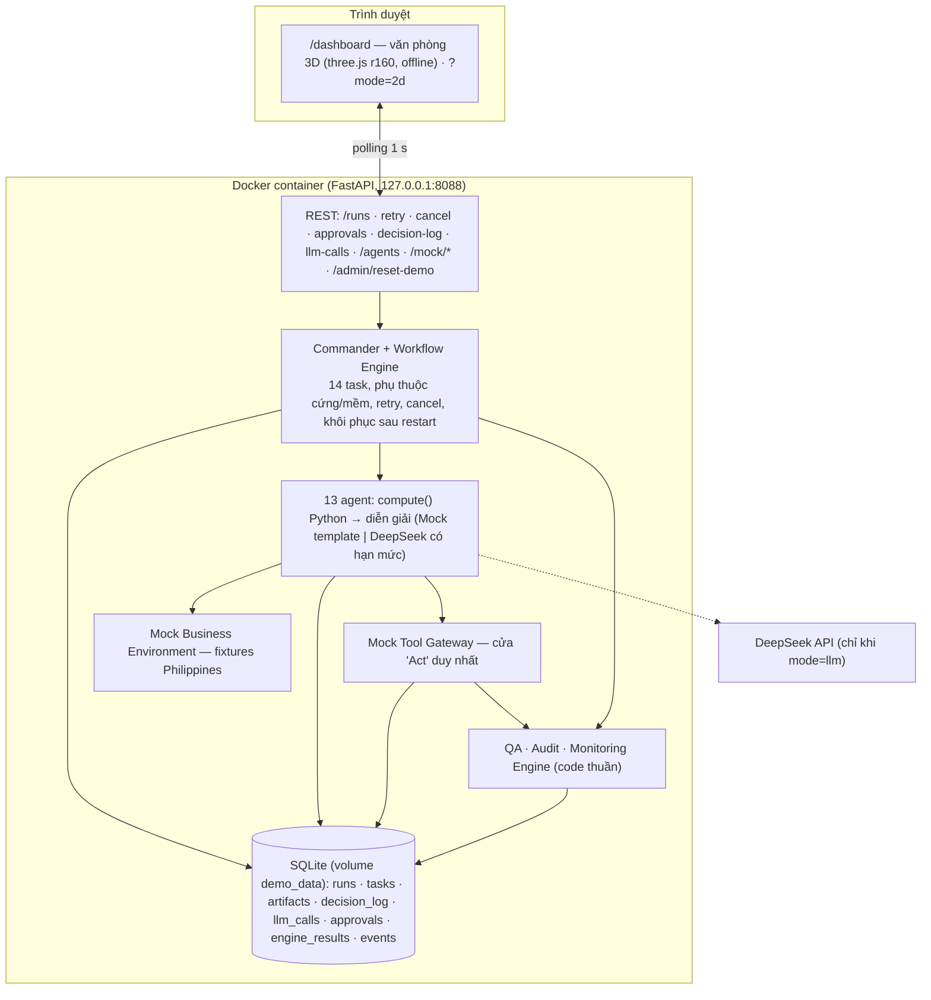

# Báo cáo cuối — Level Up 13-Agent Demo

05/11/2026. Phạm vi: `DEMO_ONLY.md` Phase 0–9. **DEMO ONLY**: chạy local, mọi dữ liệu giả lập, không kết nối hệ thống thật.

## 1. Trả lời 7 câu hỏi của DEMO_ONLY

| Câu hỏi | Trả lời | Bằng chứng |
|---|---|---|
| Đã hoàn thành bao nhiêu Phase? | **10/10** (Phase 0–9). Phase 7 là đánh giá + tích hợp một phần, không phải chuyển runtime | `DEMO_PHASE_STATUS.md`, `DEMO_TEST_REPORT.md` |
| Bao nhiêu Agent hoạt động đúng? | **13/13**: mỗi agent tạo artifact riêng, qua kiểm schema, số liệu khớp công thức; E2E S1 khẳng định 13 `agent_id`, 14 loại artifact | `tests/test_agents.py`, `tests/e2e/test_e2e_api.py::test_s1…` |
| QA/Auditor/Monitor có độc lập không? | **Có.** 3 engine là code thuần, test khẳng định không import LLM/agent; người kể "bịa" số 999999 không đổi kết luận engine (chỉ WARN phần lời văn) | `app/engines/*`, `tests/test_phase5.py` |
| Dashboard dùng được không? | **Có.** `http://localhost:8088/dashboard` văn phòng 3D + `?mode=2d`; 8/8 kịch bản trình duyệt tự động qua, kể cả Retry và xem lại run | `tests/e2e/browser/dashboard.e2e.mjs`, `tests/e2e/results/shots/` |
| ARIS tích hợp thật hay mới đánh giá? | **Đánh giá + tích hợp một phần đã chạy**: mã `planCards`/`dispatch` thật của ARIS điều khiển 4 agent LevelUp trên Docker Linux, 0 lời gọi LLM, có dự phòng. ARIS **không** làm runtime chính | `DEMO_ARIS_EVALUATION.md`, `tools/aris-adapter/` |
| Tổng lời gọi DeepSeek thực tế? | **1** (trong hạn mức 2): kiểm API tối thiểu ở Phase 9, 122 + 267 token, thành công | `DEMO_DECISIONS.md` mục "Sổ gọi LLM thật" |
| Những phần còn thiếu? | Mục 7 dưới đây | — |

## 2. Hệ thống đã xây

Luồng một run: Commander lập kế hoạch 14 bước → 9 agent nghiệp vụ chạy theo thứ tự phụ thuộc, agent sau đọc artifact của agent trước → mọi hành động ghi ra ngoài đi qua gateway (Audit quyết ALLOW / NEEDS_APPROVAL / BLOCK) → QA, Audit, Monitor chạy engine kể cả khi có agent lỗi → Commander tổng kết `DRAFT_READY` · `HOLD_DRAFT` · `NEEDS_REVIEW`.

Kết quả kịch bản mẫu (LU-PH-001): biên 226 PHP/đơn, hòa vốn 18 đơn, ROAS 1,62, lỗ 1.062 PHP sau quảng cáo → rủi ro HIGH → Commander `HOLD_DRAFT`.

## 3. Phân biệt code, mock và LLM

| Thành phần | Làm bằng | Ghi chú |
|---|---|---|
| Đồ thị nhiệm vụ, máy trạng thái, retry, cancel, khôi phục | **Code** | `app/core/graph.py`, `workflow.py` |
| Mọi con số (biên, hòa vốn, KPI, lợi nhuận, rủi ro) | **Code** trên dữ liệu mock | `app/agents/business.py` |
| QA / Audit / Monitoring | **Code** | `app/engines/*` |
| Quyền, chặn publish, giữ chờ duyệt | **Code** | `registry.py`, `gateway.py`, `engines/audit.py` |
| Thị trường, sản phẩm, NCC, ads, lead, đơn, vận chuyển, hội thoại, tài chính | **Mock** (fixtures cố định, `synthetic: true`) | `app/mock/fixtures.json` |
| Hệ thống ngoài (Meta Ads, CRM, thanh toán) | **Mock** (gateway tạo bản DRAFT trong DB) | không gọi mạng |
| Lời diễn giải của từng agent | **LLM** (DeepSeek) hoặc **template** ở Mock Mode | không được đổi số; QA cảnh báo số lạ |
| Phê duyệt vượt ngưỡng | **Con người** trên dashboard | `POST /runs/{id}/approvals/{aid}` |

## 4. Kiểm thử

| Loại | Lệnh | Kết quả 05/11/2026 |
|---|---|---|
| Unit + integration (DB tạm, không khóa DeepSeek) | `docker compose run --rm -T demo pytest -p no:cacheprovider -q` | **439 passed**, 7 skipped (bộ E2E, chạy riêng) |
| E2E API — S1…S5 + replay + phục vụ dashboard | `python tools/e2e/run_e2e.py` | **7/7** |
| E2E khởi động lại container giữa run | (cùng lệnh) | **Đạt**: task đang chạy → FAILED "interrupted", 2 task đã xong giữ nguyên, Retry → COMPLETED |
| E2E trình duyệt (Chromium trong Docker) | (cùng lệnh) | **8/8**, không lỗi console |

5 kịch bản DEMO_ONLY P8: S1 Happy Path · S2 Invalid Cost (QA FAIL `reference` 9999 ≠ 180) · S3 Unauthorized Action (Audit FAIL `blocked_action`, `allowed=0`, chiến dịch vẫn DRAFT) · S4 Agent Failure (Monitor FAIL `timeout`, kết quả cũ giữ, Retry đúng agent) · S5 No LLM (không khóa → `mode=llm` 400, Mock chạy đủ). Chi tiết: `DEMO_TEST_REPORT.md`.

Lỗi thật mà E2E tìm ra và đã sửa: khi container khởi động lại, uvicorn hủy tác vụ nền; task đang chạy bị kẹt RUNNING và không Retry được. Sửa trong `workflow._finish` / `recover` + 2 test hồi quy.

## 5. Phân công Claude / Gemini

Tỷ lệ chốt 60/40 (D-15). Gemini 4 Argon chạy 5 batch, 12 job: test bảng (đồ thị, dữ liệu, 9 agent nghiệp vụ, 3 engine, phụ thuộc mềm), 12 hội thoại giả lập, 14 mẫu văn bản, giao diện dashboard, đồ trang trí 3D, script E2E trình duyệt. Mọi output do Claude nghiệm thu bằng checker + chạy thật; sổ chi tiết `ai-jobs/LEDGER.md`. Phase 7 không giao Gemini (đánh giá/phán đoán).

## 6. Bàn giao vận hành

- Chạy: `docker compose up -d --build` → `http://localhost:8088/dashboard`. Hướng dẫn đầy đủ: `README.md`; API và biến môi trường: `DEMO_API.md`.
- Xóa dữ liệu demo: `POST /admin/reset-demo {"confirm": true}` (giữ schema, từ chối khi còn run đang chạy); xóa sạch volume: `docker compose down -v`.
- Phiên làm việc sau: đọc `AGENTS.md` → `DEMO_PHASE_STATUS.md` → `DEMO_HANDOFF.md`.
- Bước tiếp theo đã được người dùng chọn: phương án A, kế hoạch tại `DEMO_PLAN_OPTION_A.md`.

## 7. Hạn chế của bản demo

| Hạn chế | Ảnh hưởng | Hướng xử lý |
|---|---|---|
| Đồ thị 14 bước cố định; Commander không tự định tuyến | Agent chỉ chuyền kết quả theo một đường | Phương án A: phòng bàn giữa agent, vòng làm lại, nhật ký định tuyến có lý do |
| QA FAIL không tự trả việc về agent liên quan | Người phải đọc và Retry | Phương án A: vòng làm lại có giới hạn |
| Không có ký ức dài hạn, không tự học | Mỗi run như lần đầu | Phương án A: ký ức có duyệt + học có phiên bản, kiểm thử phát lại |
| Một kịch bản dữ liệu (Philippines, 3 SKU) | Không đổi thị trường từ giao diện | Thêm fixtures theo thị trường |
| Task chạy tuần tự, một container, SQLite | Không thể hiện song song/tải lớn | Đủ cho demo; production dùng Postgres/hàng đợi |
| LLM Mode chưa chạy trọn một run thật (chỉ 1 lời gọi kiểm tra) | Chất lượng diễn giải DeepSeek trên 14 agent chưa xem thực tế | Cần duyệt thêm ngân sách lời gọi |
| Chi phí ước tính = 0 khi chưa đặt giá | Cột chi phí bằng 0 | Đặt `LLM_PRICE_*_PER_M` theo bảng giá chính thức |
| `/admin/reset-demo` không có xác thực | Ai vào được `127.0.0.1:8088` đều xóa được | Chỉ chạy local; production cần RBAC/SSO |
| Image cài sẵn pytest | Image lớn hơn cần thiết | Tách image test ở bản thật |
| DB demo còn 21 dòng `llm_calls` giả từ test cũ (trước 05/11, `run_id` rỗng) | Không ảnh hưởng số theo run | Xóa bằng reset nếu muốn |
| ARIS runtime đầy đủ không tích hợp | — | Lý do và thiết kế adapter: `DEMO_ARIS_EVALUATION.md` |
| Dashboard 3D cần WebGL | Máy yếu/không WebGL | Tự chuyển 2D; `?mode=2d` |
