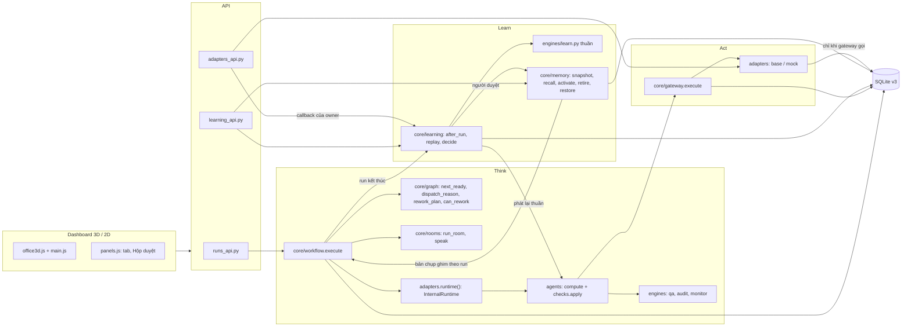
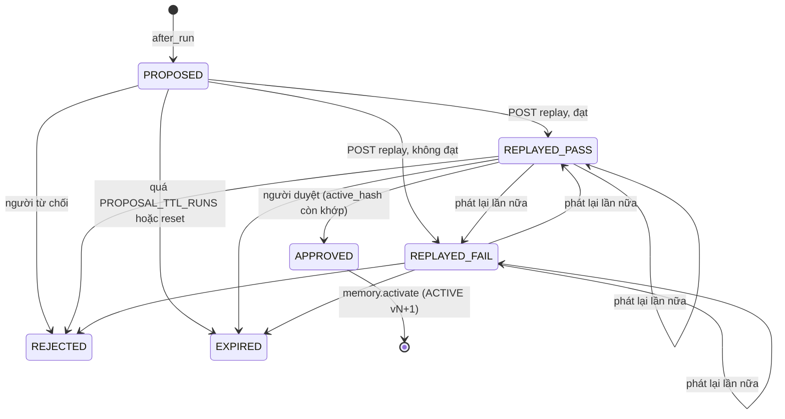

# Phương án A: phòng thảo luận, vòng làm lại, nhật ký điều phối, ký ức dài hạn và tự học, adapter mở rộng

Phiên bản 1.1, ngày 05/11/2026. Bản này sửa bản 1.0 theo ba bản phản biện (khả thi với code, ràng buộc và nguyên tắc, độ đầy đủ). Tài liệu kế thừa `DEMO_PLAN.md` (Phase 0–9).
- Nguồn phạm vi: `../../DEMO_ONLY.md`.
- Bối cảnh nghiệp vụ: `../../level-up-os-full-summary.md`.
- Đánh giá ARIS: `DEMO_ARIS_EVALUATION.md`.

Trạng thái từng phase A lấy từ `DEMO_PHASE_STATUS.md`, không lấy từ tài liệu này. **Tài liệu này là kế hoạch. Mọi tính năng ở mục 6–9 đều CHƯA có trong code**, trừ những chỗ ghi rõ "đang có" kèm tên file.

---

## 0. Tóm tắt cho chủ dự án

- Giữ runtime nội bộ: FastAPI + SQLite, 13 agent, 14 task. Không chuyển sang ARIS. Không thêm agent thứ 14.
- Phương án A thêm 5 năng lực. Cả 5 đều chạy được ở Mock Mode mà không cần LLM:
  1. **Nhật ký điều phối:** mỗi lần Commander giao việc đều ghi lý do.
  2. **Vòng làm lại:** khi QA/Audit FAIL, Commander trả việc về đúng agent kèm lỗi. Số lần có giới hạn.
  3. **Phòng thảo luận:** agent trao đổi với nhau. Số vòng và số tin có giới hạn, giống `moi_noi` của ARIS. Phòng chỉ để xem, không hành động.
  4. **Ký ức dài hạn:** agent nhớ bài học giữa các run. Ký ức có phiên bản, có giới hạn, rút lại được.
  5. **Tự học:** hệ thống tự đề xuất bài học. Đề xuất chỉ có hiệu lực sau khi qua kiểm thử phát lại tất định **và con người duyệt**.
- Các phần sau **chỉ làm cổng cắm (adapter) với bản mock**, không kết nối thật: kênh nhắn tin (Telegram/Zalo/Slack), bot lập trình ngoài (Claude Code/Codex qua ACP), Second Brain, runtime ARIS. Khi cần, cắm bản thật vào cùng giao diện mà không sửa lõi.
- Mọi tính năng mới **tắt theo mặc định ở API**, kể cả việc đọc ký ức (`use_memory=false`). Dashboard bật chúng khi trình diễn. Nhờ vậy 439 test hiện có giữ nguyên kỳ vọng, kể cả khi DB đã có ký ức ACTIVE.
- Ngân sách LLM: đã dùng 1/2 lời gọi DeepSeek thật. Phương án A dùng **0** lời gọi thật khi triển khai.

---

## 1. Mục đích và phạm vi

**Mục đích.** Cho người xem thấy 13 agent *phối hợp và tiến bộ*:
- giao việc có lý do;
- bị trả về khi sai, rồi sửa được;
- trao đổi trước khi kết luận;
- lần sau không lặp lại lỗi vì đã học.

Tất cả quan sát được trên văn phòng 3D và đều tất định: cùng đầu vào cho cùng kết quả.

**Trong phạm vi:**
- Năng lực (1)–(5) ở mục 0, làm native trong `app/`, ưu tiên thuần Python và tất định.
- Gói `app/adapters/`: giao diện (Protocol) và bản mock cho kênh nhắn tin, kênh duyệt (thẻ duyệt qua kênh), bot ngoài, Second Brain, runtime agent (nội bộ, ARIS để tắt).
- Thay đổi DB (schema v3), API, dashboard 3D/2D, test, tài liệu.

**Ngoài phạm vi:** xem mục 14.

**Giới hạn cứng (kế thừa, bắt buộc):**
- Mock Mode mặc định, chạy không cần key.
- Tối đa 2 lời gọi DeepSeek thật cho toàn dự án (D-06). Đã dùng 1.
- Không có agent thứ 14. Đồ thị giữ đúng 14 task.
- Số liệu chỉ đến từ Python trên fixtures.
- Engine tất định, không import LLM.
- Mọi "Act" ra ngoài đi qua `app/core/gateway.execute`.
- Không kết nối kênh hoặc tài khoản thật.
- Phân công Claude 60 / Gemini 40 (D-15). Gemini chỉ làm trang UI, nội dung, test dạng bảng. Gemini không viết logic lõi, không viết phần phán xét, không giữ dữ liệu phân quyền.

---

## 2. Hiện trạng và những gì thay đổi

### 2.1 Phase 8 và 9: đã đóng (tiền đề của phương án A)

Theo `DEMO_PHASE_STATUS.md` (cập nhật 05/11/2026), Phase 0–9 đều **DONE**:

| Hạng mục | Bằng chứng đang có |
|---|---|
| Bộ test | `pytest` trong container: **439 passed, 7 skipped**. 7 test bị skip là test E2E HTTP, chỉ chạy qua `run_e2e.py`. Ghi ở `DEMO_TEST_REPORT.md` |
| E2E API | `tests/e2e/results/latest.json`: `api.ok = true`, 7 passed (S1–S5, replay, dashboard) |
| E2E khởi động lại | Kịch bản restart PASS trong `latest.json` |
| E2E trình duyệt | `tests/e2e/browser/dashboard.e2e.mjs`: mục `browser` trong `latest.json`, 8 passed, 0 failed |
| Đóng gói | README, `docs/DEMO_API.md`, `POST /admin/reset-demo`, `docs/DEMO_FINAL_REPORT.md` |
| Sổ gọi LLM | `DEMO_DECISIONS.md`, mục "Sổ gọi LLM thật": 1 lời gọi (Phase 9, kiểm tra API). Dòng 3 của STATUS ghi 1/2, khớp sổ |

**Cổng vào phương án A:**
1. Chạy lại bộ test đầy đủ và `tools/e2e/run_e2e.py` trên code hiện tại.
2. Ghi số liệu làm **mốc cơ sở** (baseline) trong `DEMO_TEST_REPORT.md`.
3. Gắn tag cho image hiện tại là `levelup-vmm-demo:baseline-v2`. Kịch bản E2E migrate ở A10 dùng tag này.

Mỗi lát A sau đó phải giữ mốc này xanh.

### 2.2 Hôm nay so với sau phương án A

| Khía cạnh | Hôm nay (đang có) | Sau phương án A (kế hoạch) |
|---|---|---|
| Giao việc | `execute()` chọn task bằng `graph.next_ready`, ghi `task_completed`, không ghi lý do giao | Thêm dòng `dispatch` (lý do, trạng thái phụ thuộc, lần thử) và dòng `dispatch_result` (done/failed/interrupted) |
| QA/Audit FAIL | Task supervisor vẫn COMPLETED với artifact FAIL; summary kết luận `NEEDS_REVIEW` | Nếu bật `max_rework`, Commander trả việc về agent chịu trách nhiệm kèm lỗi, trước khi Monitor chạy. Agent sửa bằng phép kiểm tất định. Tối đa 2 vòng |
| Trạng thái task | `TRANSITIONS[COMPLETED]` rỗng; `can_rerun` chỉ cho task mềm | Giữ nguyên `TRANSITIONS`. Thêm ngoại lệ riêng `can_rework`, chỉ đường làm lại mới dùng được |
| Gateway | Mỗi lần gọi ghi một dòng `tool_call`; `tool_calls()` trả mọi dòng | Gắn lần thử. Luôn chạy `audit.check_action` trước. Chỉ dùng lại kết quả cũ khi hash hành động và phán quyết trùng. Audit chỉ xem lời gọi của lần thử hiện tại |
| Trao đổi giữa agent | Chỉ bàn giao artifact theo phụ thuộc | Phòng thảo luận có giới hạn vòng và tin, chỉ để xem |
| Ký ức | Không có. Mỗi run độc lập | `memory_items` có phiên bản, ghim theo run khi `use_memory=true`, giới hạn theo agent |
| Học | Không có ("không có Learn trong demo", `DEMO_PLAN.md` §1.1) | Đường học tách riêng: tín hiệu, đề xuất, phát lại, người duyệt, kích hoạt, rút lại |
| Duyệt HITL | `approvals` (PENDING/APPROVED/REJECTED); `decide_approval` lấy câu trả lời đầu tiên, câu sau nhận 409 | Thêm cột `tool` và `decided_by` (do server đặt). Một "Hộp duyệt" chung cho phê duyệt hành động và đề xuất học. Thẻ duyệt qua kênh mock |
| Hệ thống ngoài | Nhánh ALLOW của gateway trả dict `DRAFT` chung | Tra adapter theo tiền tố tool. Mặc định vẫn là dict cũ |
| Runtime | Có sẵn chỗ cắm `workflow.HANDLERS` / `DEFAULT_HANDLER`. ARIS chỉ có `tools/aris-adapter/spike.mjs` | `_run_task` lấy handler qua cổng `AgentRuntime`: `InternalRuntime` (đang dùng), `ArisRuntime` (luôn tắt, rơi về nội bộ) |
| DB | `SCHEMA_VERSION = 2`, 8 bảng | v3: thêm cột bằng `ALTER` có điều kiện, thêm bảng mới, không đổi CHECK cũ |

---

## 3. Đính chính: tự học không mâu thuẫn với "Think ≠ Act ≠ Learn"

Một tin nhắn trước đó của trợ lý nói rằng tự học trái nguyên tắc "Think ≠ Act ≠ Learn". **Câu đó sai.** Nguyên tắc này đòi **tách** ba đường, không cấm học:

| Đường | Ai làm | Module | Được phép ghi gì |
|---|---|---|---|
| Think | Agent tính toán, engine phán xét | `app/agents/*`, `app/engines/qa|audit|monitor.py` | artifact, `engine_results`. Agent không tự ghi DB: `workflow` ghi thay |
| Act | Chỉ gateway | `app/core/gateway.py` (+ `app/adapters` do gateway gọi) | `tool_call`, DRAFT, `approvals`, `channel_outbox`, `brain_inbox` |
| Learn | Đường học chạy sau khi run kết thúc | `app/engines/learn.py` (thuần), `app/core/learning.py` | **chỉ đề xuất** (`learning_proposals`), nhật ký (`learning_runs`), bộ đếm (`learning_meta`). Không ghi bảng adapter. Thẻ `lp:` được dựng khi đọc, không lưu |

Đề xuất chỉ thành ký ức có hiệu lực khi đủ ba điều kiện:
1. Phát lại tất định cho kết quả không xấu hơn.
2. Không chạm guardrail.
3. **Con người duyệt.**

Nếu đủ, hệ thống kích hoạt đề xuất qua một chốt duy nhất là `memory.activate()`. Ký ức có phiên bản và rút lại được. Agent chỉ *đọc* ký ức đã duyệt, qua bản chụp ghim theo run, và chỉ khi run bật `use_memory`.

Nguyên tắc "Rules First, AI Second" vẫn giữ: tín hiệu, đề xuất, phát lại đều là code. LLM không quyết định gì trong đường học.

Khi làm A0, sửa dòng "Think ≠ Act ≠ Learn" trong bảng §1.1 của `DEMO_PLAN.md` theo nội dung mục này.

---

## 4. Yêu cầu truy vết

Mã `A-Rnn` dùng xuyên suốt STATUS, TEST_REPORT và HANDOFF.

| Mã | Yêu cầu | Phase |
|---|---|---|
| A-R01 | Mỗi lần task bắt đầu có đúng 1 dòng `dispatch` (luật hard/soft/rework, trạng thái phụ thuộc, lý do, lần thử). Mỗi lần task kết thúc có đúng 1 dòng `dispatch_result` với `outcome` là `done`/`failed` (trong `_run_task`/`_fail`) hoặc `interrupted` (trong `_interrupt_orphans`) | A1 |
| A-R02 | Gateway gắn lần thử và luôn chạy `audit.check_action` trước. Chỉ dùng lại kết quả cũ khi trùng `(run_id, task_key, tool, target, action_hash)` và trùng phán quyết. Dòng dùng lại chép đủ `detail` gốc. Audit chỉ đọc lời gọi của lần thử hiện tại | A3 |
| A-R03 | Vòng làm lại: khi QA/Audit FAIL sửa được, Commander trả về task sớm nhất chịu trách nhiệm kèm phát hiện, trước khi Monitor chạy. Tối đa `max_rework` vòng. Không sửa được thì 0 vòng | A4 |
| A-R04 | Phòng thảo luận: thành viên là agent sẵn có; giới hạn vòng và tin; có PASS và lý do bỏ qua; không tạo task, artifact, `tool_call` hay approval | A5 |
| A-R05 | Ký ức dài hạn: các tầng, mô hình dữ liệu, ghim theo run (`use_memory`), giới hạn, quyền riêng tư, có phiên bản, rút lại và khôi phục được. Mọi lần ghi đi qua `memory.activate()` | A6 |
| A-R06 | Tự học: tín hiệu tất định, sinh đề xuất, phát lại chỉ đọc (gọi tường minh), người duyệt, kích hoạt, hết hạn, rút lại | A7 |
| A-R07 | Guardrail không bao giờ học được (`APPROVAL_THRESHOLD_PHP`, quyền agent, `WRITE_EXTERNAL`, luật engine). DENY so khớp trên `key` và nội dung. Phép kiểm `learnable=False` không bao giờ thành ký ức | A7 |
| A-R08 | Adapter mock: kênh, kênh duyệt, bot ngoài, Second Brain, runtime. Không mạng, không subprocess. `ADAPTER_MODE` khác `mock` thì không khởi động. Adapter chỉ ghi DB qua đường gateway | A8a, A8b |
| A-R09 | Dashboard: mỗi lát có hiệu ứng 3D riêng, chế độ 2D đủ thông tin, các tab mới, Hộp duyệt chung | A1, A4–A9 |
| A-R10 | API mới kiểm đầu vào: 400 sai định dạng, 403 không có quyền, 404 không có, 409 xung đột trạng thái, 422 ngoài miền hoặc trường lạ | A4–A9 |
| A-R11 | Test: bảng cho hàm thuần, tích hợp, E2E S6–S9, trình duyệt; mốc cơ sở luôn xanh; test không rò ký ức sang nhau | mọi phase |
| A-R12 | Mock Mode đủ chức năng không cần LLM; 0 lời gọi DeepSeek thật trong phương án A | mọi phase |
| A-R13 | Đúng 13 agent và 14 task; số chỉ từ Python; engine không import LLM | mọi phase |
| A-R14 | Tính năng mới tắt mặc định ở API, kể cả khi DB có ký ức ACTIVE; kỳ vọng test cũ không đổi | mọi phase |
| A-R15 | Tài liệu `DEMO_*.md` cập nhật theo từng lát; phụ lục phương án A trong `DEMO_FINAL_REPORT.md` | A0, A10 |

---

## 5. Bất biến an toàn (mọi lát phải giữ)

1. **Tắt hoặc trơ theo mặc định.**
   - Mặc định của `RunRequest`: `max_rework = 0`, `rooms = false`, `use_memory = false`.
   - Chỉ ghim `memory_ids` khi `use_memory=true` **và** `MEMORY_READ=1`. Run API mặc định không bao giờ đọc ký ức, kể cả khi DB đã có ký ức ACTIVE.
   - Hệ quả phải giữ: happy path vẫn đúng 8 dòng `tool_call`; S2, S3 vẫn kết thúc `NEEDS_REVIEW`; `test_bad_cost_propagates…` vẫn thấy 9999.
   - `memory_notes`, `rework_feedback`, `memory_used`, `checks_applied` chỉ được thêm khi khác rỗng. Không bao giờ ghi `[]` hay `null`.
2. **Từ vựng đóng.** Phép sửa của vòng làm lại và phép kiểm học được đều là mục trong bảng Python cố định `app/agents/checks.py:CHECKS`. Mỗi mục có cờ `learnable`. Đường học chỉ *bật* phép kiểm có sẵn và `learnable=True` cho một phạm vi, không tạo hành vi mới.
3. **Số chỉ từ Python và fixtures.** Ký ức và phòng thảo luận không cung cấp số. Phép kiểm đọc lại dữ liệu mock, ví dụ `data.fixture('suppliers')`.
   - Mọi lần phép kiểm cấp facts đổi một giá trị đều được ghi `{field, before, after, source:'fixture'}`.
   - Nếu thay đổi đến từ ký ức, Monitor báo WARN `memory_override`.
4. **Học chỉ ghi đề xuất.**
   - `learn.py` thuần, chỉ dùng stdlib.
   - `learning.py` chạy sau khi run kết thúc, trong transaction riêng, và không đổi được trạng thái run.
   - Đường học không ghi bảng adapter.
5. **Guardrail không học được.**
   - `learn.DENY` so khớp trên `key` **và mọi chuỗi trong `content`/`params`** (kể cả tên tham số).
   - Kiểm ở ba chốt (sinh, phát lại, duyệt) và một lần nữa trong `memory.activate()`.
   - Phép kiểm `learnable=False` (ví dụ `drop_blocked_action`) bị từ chối ở mọi chốt.
6. **Tái lập được.** Mỗi run ghim bản chụp ký ức (`runs.memory_ids`). Phát lại run cũ dùng đúng bản chụp đó.
7. **Act chỉ qua gateway.**
   - Adapter chỉ có bản mock và chỉ ghi DB khi được gateway gọi.
   - `/health` giữ `live_integrations: False`.
   - Nội dung từ ngoài mang `trust='external'`. Nó không bao giờ thành phép kiểm hay tầng lõi, và không bao giờ được coi là chỉ thị.
   - Danh tính trong mock (`sender_id`) là *tự khai*, không được xác minh.
8. **Phòng thảo luận chỉ để xem.** Phần sửa của vòng làm lại chỉ lấy từ phát hiện của `rework_plan`, không lấy từ lời thoại trong phòng. Nhờ vậy, sau này dù `speak` dùng LLM cũng không đổi được thứ được sửa.
9. **`TRANSITIONS` không sửa.**
   - Làm lại task nghiệp vụ đi qua `graph.can_rework`, và chỉ được dùng khi gọi `_move(..., rework=True)`.
   - Task mềm được đặt lại qua `can_rerun` đang có.
   - Giữ bảng 38 cặp và bất biến của `retry()`.
10. **Công tắc qua env** (giá trị ngoài miền thì báo lỗi rõ ràng, không tự kẹp):

    | Biến | Mặc định trong code | `compose.yaml` (trình diễn) | `tests/conftest.py` | Khi tắt |
    |---|---|---|---|---|
    | `MEMORY_READ` | `0` | `1` | `0` | Mọi run mới ghim `memory_ids=[]`. Đây là công tắc tắt khẩn cho mọi tác dụng của ký ức và tự học, có test riêng |
    | `LEARNING_ENABLED` | `0` | `1` | `0` | `after_run` trả về ngay, không ghi gì |
    | `REVIEW_CHANNEL` | `off` | `off` | `off` | Gateway không soạn thẻ `ap:` |
    | `MAX_REWORK_CEILING` | `2` | — | — | — |
    | `ROOM_MAX_ROUNDS`, `ROOM_MAX_MESSAGES` | `3`, `10` | — | — | — |
    | `ADAPTER_MODE` | `mock` | `mock` | `mock` | Giá trị khác thì không khởi động |
    | `AGENT_RUNTIME` | `internal` | `internal` | — | Giá trị khác thì ghi `runtime_fallback` và dùng nội bộ |

---

## 6. Kiến trúc đích

### 6.1 Sơ đồ module



Mũi tên duy nhất từ Learn sang Think là **bản chụp ký ức đã duyệt**. Bản chụp được đọc khi tạo run, và chỉ khi run có `use_memory=true`. Learn không gọi gateway, không sửa run, không ghi bảng adapter.

### 6.2 File mới và file sửa

| File | Mới / sửa | Người làm | Nội dung |
|---|---|---|---|
| `app/core/graph.py` | sửa | Claude | Hàm thuần `dispatch_reason()`, `rework_plan()`, `can_rework()`, bảng lý do `DISPATCH_REASON`. Không sửa `TRANSITIONS` |
| `app/core/workflow.py` | sửa | Claude | Xem danh sách ngay dưới bảng |
| `app/core/gateway.py` | sửa | Claude | Tham số `attempt`; ghi `approvals.tool`; luôn `check_action` trước, rồi chống trùng theo `action_hash`; nhánh ALLOW gọi `adapters.draft()`; khi tạo approval và `REVIEW_CHANNEL=mock` thì gọi `adapters.notify_approval()` |
| `app/core/registry.py` | sửa | Claude | `channel.reply_draft`, `brain.capture` là WRITE_DRAFT. `brain.search`, `brain.read` là READ (mở rộng luật tiền tố). `external.*` không liệt kê, nên bị BLOCK |
| `app/core/rooms.py` | mới | Claude | Hàm thuần `triggers()`, `run_room()`; hàm `template_speak()`; `save_room()` ghi DB (do `workflow` gọi) |
| `app/core/memory.py` | mới | Claude | `snapshot()`, `recall()`, `activate()` (chốt ghi duy nhất: lint + DENY + giới hạn + `BEGIN IMMEDIATE`), `retire()`, `restore()` |
| `app/core/learning.py` | mới | Claude | `after_run()`, `collect()`, `expire()`, `replay()`, `decide()` |
| `app/agents/checks.py` | mới | Claude | `CHECKS` (kèm cờ `learnable`, cấp `facts`/`artifact`), `FIX`, `apply_facts()`, `apply_artifact()`. Thuần: chỉ đọc `facts` và fixtures |
| `app/agents/__init__.py` | sửa | Claude | `compute()` gọi `checks.apply_artifact(art, ctx.checks, ctx.task_key)` sau đoạn thêm `publish_attempt`, trước khi trả về. `handle()` truyền `ctx.attempt` cho gateway, trả `art['memory_used']=[{id,version}]` và `art['checks_applied']=[…]` khi khác rỗng, ép narrative mock khi `ctx.rework`. **Không ghi DB** |
| `app/engines/learn.py` | mới | Claude | Thuần, chỉ stdlib: `propose()`, `lint()`, `summarize()`, `routing_stats()`, `DENY` |
| `app/engines/monitor.py` | sửa | Claude | Luật WARN `reworked`, `rework_exhausted`, `memory_override` (giữ M-31), đọc từ `evidence['rework']` và `evidence['overrides']` |
| `app/adapters/base.py` | mới | Claude | Protocol, dataclass, hằng phân quyền `ROLES` và `PAGE_DEPT`, hàm thuần `access_decide()`, `can_read()`, `parse_callback()` |
| `app/adapters/mock.py` | mới | Claude | `MockChannel`, `MockReviewChannel`, `MockExternalDriver`, `MockVault`, `InternalRuntime`, `ArisRuntime` (tắt) |
| `app/adapters/__init__.py` | mới | Claude | `ADAPTERS`, `draft()`, `notify_approval()`, `runtime()`, `public()`, `assert_mock_mode()` |
| `app/db.py` | sửa | Claude | Schema v3 (mục 6.3) |
| `app/runs_api.py`, `app/learning_api.py` (mới), `app/adapters_api.py` (mới), `app/main.py` | sửa / mới | Claude | Endpoint (mục 8.1). `lifespan()` gọi `assert_mock_mode()` trước `recover()` |
| `compose.yaml` | sửa | Claude | `environment: MEMORY_READ=1, LEARNING_ENABLED=1` cho bản trình diễn |
| `tests/conftest.py` | sửa | Claude | Đặt `MEMORY_READ=0`, `LEARNING_ENABLED=0`, `REVIEW_CHANNEL=off`. Sửa docstring cho đúng: một file DB cho cả phiên pytest |
| `tools/e2e/run_e2e.py` | sửa | Claude | Container `lu-e2e` thêm `-e MEMORY_READ=1 -e LEARNING_ENABLED=1`. Thêm container `lu-e2e-hitl` (cổng 8092). Thêm kịch bản migrate từ image `baseline-v2` |
| `app/llm/room_texts.json`, `app/llm/lesson_texts.json` | mới | Gemini | Mẫu câu tiếng Việt, chỉ có `{placeholder}` do Claude chốt trước, không có số viết sẵn |
| `app/mock/adapter_fixtures.json` | mới | Gemini | Chỉ văn bản: tin nhắn vào mẫu, các bước mẫu của bot ngoài. **Không** chứa danh sách owner/member hay vai trò |
| `app/mock/brain/*.md` | mới | Gemini | 4–6 trang vault mẫu có `[[liên kết]]`. **Không** có front matter phân quyền (`dept:`) |
| `app/web/oa-copy.js` | mới | Gemini | Chỉ chứa dữ liệu: chữ trên bong bóng, nhãn 3D, giá trị khởi tạo của form (theo mẫu `office-props.js`) |
| `app/web/panels.js`, `app/web/styles.css` | sửa | Gemini | 5 tab mới, chế độ 2D |
| `app/web/main.js`, `app/web/office3d.js` | sửa | Claude | Xử lý sự kiện, hoạt cảnh |
| `tests/e2e/browser/dashboard.e2e.mjs` | sửa | Gemini (Claude review) | `startDemo()` nhận `{maxRework, rooms, useMemory}`, mặc định `0/false/false`. 8 ca cũ giữ kỳ vọng. Thêm ca mới |

Các thay đổi trong `app/core/workflow.py`:
- `Ctx` thêm `feedback`, `memory`, `rework`, `checks: tuple = ()`, tất cả có giá trị mặc định.
- `create_run` nhận `max_rework`, `rooms`, `use_memory`; ghim `memory_ids` khi `use_memory` và `MEMORY_READ=1`; tăng `learning_meta.run_seq`.
- Trong `execute()`: ghi `dispatch`; móc làm lại khi `next_ready` trả `'monitor'`; móc phòng `risk` khi `next_ready` trả `'summary'` (đúng một lần mỗi run); nạp ký ức.
- `_run_task`: lấy handler qua `adapters.runtime().run_task(ctx)`. Giữ phần `isawaitable`/`wait_for` ở chỗ cũ. Tách `memory_used`/`checks_applied` khỏi payload rồi ghi `memory_recall`/`check_applied` và cập nhật `uses`/`last_used_run` trong cùng `db.tx()` với `task_completed`, cùng với `dispatch_result`.
- `_interrupt_orphans` ghi `dispatch_result {outcome:'interrupted'}`.
- `_move(..., rework=False)`.
- `tool_calls()` lọc theo lần thử.
- `evidence()` thêm `rework: {reworked_tasks, exhausted}` và `overrides`.
- `get_run` thêm `last_dispatch`, `memory_used` cho từng task, cùng `rework` và `rooms_summary`.
- `cancel()` ghi `decided_by='system:cancel'`.
- `decide_approval(..., by='user')` do server đặt.
- Gọi `learning.after_run` ở `_finish`, `decide_approval` và `recover()`.
- Mở rộng `RESET_TABLES`.

Lưu ý: `app/mock/fixtures.json` hiện là **một file**, không phải thư mục. Vì vậy dữ liệu adapter đặt ở `app/mock/adapter_fixtures.json`.

### 6.3 DB schema v3 (`app/db.py`)

Quy tắc migrate:
- Đặt `SCHEMA_VERSION = 3`. Đọc phiên bản cũ trước khi cập nhật.
- Thêm cột bằng cách kiểm `PRAGMA table_info` trước, chỉ `ALTER` khi cột chưa có. Như vậy migrate chạy lại không lỗi và volume v2 giữ nguyên run cũ (M-06).
- Không đổi CHECK nào đang có. Không thêm trạng thái task/run. Không thêm giá trị mới vào `engine_results.engine`.
- `memory_items`, `learning_proposals`, `learning_meta` **không có FOREIGN KEY** tới `runs`.

| Bảng / cột | Mục đích | Ràng buộc chính |
|---|---|---|
| `runs.max_rework INTEGER NOT NULL DEFAULT 0` | Số vòng làm lại tối đa của run | ALTER |
| `runs.rooms INTEGER NOT NULL DEFAULT 0` | Bật phòng thảo luận | ALTER |
| `runs.use_memory INTEGER NOT NULL DEFAULT 0` | Run có đọc ký ức không | ALTER |
| `runs.memory_ids TEXT NOT NULL DEFAULT '[]'` | Bản chụp ký ức ghim khi `create_run` | ALTER |
| `approvals.tool TEXT` | Tool của hành động cần duyệt (gateway ghi) | ALTER, cho phép NULL (dòng cũ) |
| `approvals.decided_by TEXT` | `user` / `channel:<kind>` / `system:cancel` | ALTER, cho phép NULL |
| `rework_requests(id, run_id, round, target_task, agent_id, source_result_ids, findings, checks, status, prev_hash, created_at, resolved_at)` | Sổ làm lại. `source_result_ids` là JSON vì một vòng có thể gộp FAIL của cả QA và Audit | `status IN ('OPEN','RESOLVED','EXHAUSTED','NO_CHANGE')`; `UNIQUE(run_id, round)` |
| `rooms(id, run_id, kind, topic, participants, max_rounds, max_messages, rounds_used, messages_used, status, created_at, closed_at)` | Phòng thảo luận | `kind IN ('rework','risk')`, `status IN ('DONE','STOPPED','LIMIT')` |
| `room_messages(id, room_id, run_id, round, agent_id, kind, reason, text, source, refs, number_warn, ts)` | Lời thoại | `kind IN ('say','pass','skip')`, `source IN ('mock','llm','mock_budget')` |
| `memory_items(id, key, version, agent_id, sku, task_key, kind, tier, trust, content, text, status, proposal_id, created_by, uses, last_used_run, created_at, retired_at)` | Ký ức dài hạn | Xem các ràng buộc ngay dưới bảng |
| `learning_proposals(id, key, kind, agent_id, sku, task_key, content, text, evidence, source_runs, support, status, replay, generator_version, decided_by, decided_at, created_at, created_run_seq)` | Hàng chờ duyệt. `replay` là JSON gồm kết quả và `active_hash` | `status IN ('PROPOSED','REPLAYED_PASS','REPLAYED_FAIL','APPROVED','REJECTED','EXPIRED')`; chỉ mục duy nhất một phần `ON (key) WHERE status IN ('PROPOSED','REPLAYED_PASS','REPLAYED_FAIL')` |
| `learning_runs(id, run_id, learn_seq, reasons, proposed, skipped, error, created_at)` | Nhật ký mỗi lượt học | `UNIQUE(run_id, learn_seq)` (mục 7.5) |
| `learning_meta(k TEXT PRIMARY KEY, v INTEGER NOT NULL)` | Bộ đếm bền `run_seq`, tăng trong `create_run` | Không bao giờ bị reset xóa |
| `channel_inbox(channel, account, message_id, chat_id, sender_id, text, trust, decision, ts, PRIMARY KEY(channel, account, message_id))` | Tin vào kênh mock | Chống trùng bằng `INSERT OR IGNORE` |
| `channel_outbox(id, channel, account, chat_id, text, buttons, ref_kind, ref_id, state, attempts, created_at)` | Tin ra dạng nháp, không bao giờ gửi. Chỉ đường gateway ghi | `state IN ('DRAFT','SENT_MOCK')`, `attempts <= 3` |
| `brain_inbox(id, by_agent, text, source, trust, status, created_at)` | Ghi nhận vào Second Brain (chỉ hộp thư vào), ghi qua gateway `brain.capture` | `status IN ('NEW','ACCEPTED','REJECTED')` |

Ràng buộc của `memory_items`:
- `kind IN ('check','lesson','preference')`
- `tier IN ('core','archive')`
- `trust IN ('user','derived','external')`
- `status IN ('ACTIVE','RETIRED')`
- `CHECK(NOT(kind='check' AND trust='external'))`
- `CHECK(NOT(tier='core' AND trust='external'))`
- `UNIQUE(key, version)`
- chỉ mục duy nhất một phần `ON memory_items(key) WHERE status='ACTIVE'`

Quy tắc chỉ mục và reset:
- Đánh chỉ mục trên `run_id` cho mọi bảng theo run.
- `RESET_TABLES` thêm các bảng theo run và bảng adapter. Xóa bảng con trước, vì `foreign_keys = ON`: `room_messages, rooms, rework_requests, learning_runs, channel_outbox, channel_inbox, brain_inbox`.
- **Reset không có `include_memory`:** giữ `memory_items` và `learning_proposals` đã quyết (OA-D05). Đề xuất đang mở (`PROPOSED`/`REPLAYED_*`) chuyển sang `EXPIRED`, vì run nguồn đã bị xóa.
- **Reset có `include_memory: true`:** xóa thêm `memory_items` và `learning_proposals`.
- `learning_meta` không bao giờ bị xóa.
- Mỗi adapter có bảng riêng có kiểu (OA-D08) thay vì một bảng chung. Bảng cho bot ngoài (`external_jobs`) **chưa tạo** ở phương án A, vì không có đường nào ghi vào nó (mục 7.6). Bảng này thêm khi có driver thật.

---

## 7. Thiết kế chi tiết

### 7.1 Nhật ký điều phối có lý do (A1)

- **Hàm thuần** `graph.dispatch_reason(key, statuses, graph, soft, rework_round=0) -> {'rule': 'hard'|'soft'|'rework', 'deps': {dep: status}, 'reason': str}`:
  - `rework` khi `rework_round > 0`;
  - `soft` khi `key in soft` và có phụ thuộc không COMPLETED;
  - còn lại là `hard`;
  - `reason` lấy từ bảng tĩnh `DISPATCH_REASON[key]` (ví dụ `'qa': 'đủ 9 artifact nghiệp vụ đã kết thúc'`), cộng thêm danh sách phụ thuộc chưa xong nếu có.
- **Móc:** trong `execute()`, ngay sau khi `_move(c, run_id, key, PENDING, RUNNING, …)` thành công, gọi `_decision(c, run_id, 'dispatch', key, g.TASKS[key][0], detail={**dispatch_reason(...), 'attempt': attempt, 'rework_round': r})`.
- **Kết quả:** ghi `_decision(..., 'dispatch_result', detail={'outcome': ..., 'attempt': n})` ở ba chỗ:
  - `done`: cạnh `task_completed` trong `_run_task`;
  - `failed`: trong `_fail`;
  - `interrupted`: trong `_interrupt_orphans`. Hàm này được gọi từ `_finish` và `recover()`.
- **Không thêm bảng.** Tab Nhật ký và `GET /runs/{id}/decision-log` đang có đã hiển thị được.
- **Cho 3D:** `get_run` thêm `last_dispatch: {rule, reason}` cho từng task.
- **Thống kê "ai giỏi việc gì":** `learn.routing_stats(rows)` tính theo agent × task_key: số lần, số done, số failed, số lần bị làm lại, tỷ lệ. Ý tưởng chuyển từ `learnedFrom` của ARIS (xem bảng tham chiếu ở 7.6).
  - **Chỉ để hiển thị**, vì chủ của mỗi task là cố định. Không có định tuyến tự động.
- **An toàn với test cũ:** các test hiện tại lọc theo `task_completed` / `tool_call`, nên dòng mới không ảnh hưởng.

### 7.2 Vòng làm lại (A3 + A4)

**Sự thật trong code hiện tại.**
- QA/Audit FAIL không làm task FAILED. `supervise()` lưu `engine_results`, còn task `qa`/`audit` vẫn COMPLETED với artifact FAIL. Task nghiệp vụ gây lỗi cũng COMPLETED.
- `TASKS['monitor']` phụ thuộc `qa` và `audit`. `summary` phụ thuộc `monitor` (`app/core/graph.py`).
- Agent mock là hàm thuần, nên chạy lại với cùng `facts` sẽ ra lại 9999. Vì vậy cần phép sửa tất định.

**A3: gateway an toàn khi chạy lại (làm trước A4).**
- `gateway.execute(run_id, task_key, agent_id, action, attempt=1)`:
  - lưu `attempt` và `action_hash` (sha256 của JSON chuẩn hóa toàn bộ `action`) trong `detail`;
  - ghi `approvals.tool`.
  - `agents.handle()` truyền `ctx.attempt`.
- **Chống trùng (không bỏ qua HITL):**
  1. **Luôn** gọi `audit.check_action` trước.
  2. Chỉ dùng lại kết quả cũ khi đã có dòng `tool_call` không phải BLOCK cùng `(run_id, task_key, tool, target, action_hash)` **và** phán quyết mới trùng phán quyết cũ. Không thỏa thì chạy đường thường: ngân sách đổi qua ngưỡng sẽ tạo approval mới.
  3. Khi dùng lại: không tạo DRAFT hay approval mới, nhưng vẫn **ghi một dòng `tool_call` mới** chép đủ `detail` gốc (`decision`, `target`, `reason`, `result`) cộng `reused: true` và `attempt` hiện tại. Nhờ vậy tập `seen` của `audit.run` không báo `not_via_gateway`.
- **Lọc theo lần thử:** `workflow.tool_calls(run_id)` chỉ giữ dòng có `attempt` bằng `tasks.attempt` hiện tại của task đó. Dòng cũ thiếu `attempt` được coi là 1.
  - Hàm này đang được gọi từ `app/agents/__init__.py` (Audit).
  - Test E2E (`tests/e2e/test_e2e_api.py`) đọc decision-log qua HTTP, không gọi hàm này. Kỳ vọng của nó vẫn phải giữ.
  - `retry()` cũng tăng `tasks.attempt`, nên cần test hồi quy: task được retry thì Audit vẫn thấy lời gọi của lần thử hiện tại.
- **Test cần approval:** ngưỡng mặc định 5000 lớn hơn ngân sách campaign 4000, nên mặc định không có approval nào. Test cần approval phải dùng `monkeypatch.setenv('APPROVAL_THRESHOLD_PHP','3000')` như `tests/test_phase5.py`.

**A4: vòng làm lại.**

1. **Điểm quyết định.** Trong `execute()`, khi `g.next_ready(...)` trả `'monitor'` và `run.max_rework > 0`. Lúc này QA và Audit đã xong, Monitor chưa chạy.
   - Đọc `engine_results` mới nhất của qa và audit, cùng truy vấn với `get_run`.
   - Chốt yêu cầu của vòng trước (bước 7, bước 8).
   - Gọi `g.rework_plan(findings, statuses, rounds_used, g.GRAPH, g.SOFT, max_rework, fixable=checks.FIX)`.
2. **Kết quả của `rework_plan`:** `{'target', 'agent_id', 'changes': {task: (COMPLETED, PENDING)}, 'findings', 'checks', 'reason'}` hoặc `(None, lý_do)`.
   - Trả `None` khi:
     - có task `BUSINESS` FAILED/SKIPPED (lý do `business_task_not_completed`, kiểm đầu tiên);
     - không có FAIL;
     - không có FAIL nào có luật trong `FIX` (lý do `no_fixable_rule`);
     - `rounds_used >= max_rework` (lý do `exhausted`).
   - **Đích** là task sớm nhất theo thứ tự topo trong `BUSINESS` có FAIL sửa được. Với `bad_cost`, QA `reference` gắn cả `product` và `offer`, nên đích là `product`. Agent là `g.TASKS[target][0]`.
   - **`changes`** chỉ chứa cặp COMPLETED→PENDING:
     - đích;
     - mọi hậu duệ không mềm của đích, vì chúng đã dùng artifact sai;
     - các task mềm đã COMPLETED (`qa`, `audit`).
3. **Chuyển trạng thái.**
   - Task nghiệp vụ dùng `g.can_rework(task, src, dst)`, chỉ cho COMPLETED→PENDING. `_move(..., rework=True)` kiểm nó cùng với `can_transition`.
   - `qa`/`audit` đặt lại qua `can_rerun` đang có.
   - Chỉ đường làm lại truyền `rework=True`. `TRANSITIONS`, `retry()`, `retry_plan()` giữ nguyên.
4. **Bảng sửa** `checks.FIX` (từ vựng đóng):

   | Luật phát hiện | Phép kiểm | Cấp áp dụng | `learnable` | Tác dụng |
   |---|---|---|---|---|
   | QA `reference` (giá vốn lệch tham chiếu) | `verify_supplier_cost:<sku>` | facts, toàn run | True | Thay `suppliers[sku].unit_cost_php` trong `ctx.facts` bằng giá trong `data.fixture('suppliers')`, mô phỏng "nhà cung cấp báo giá lại" (OA-D01). Ghi `{field, before, after, source:'fixture'}` |
   | Audit `blocked_action` | `drop_blocked_action:<tool>` | artifact của task bị gắn lỗi | **False** (chỉ dùng khi làm lại) | Bỏ hành động bị chặn khỏi `requested_actions` trước khi gọi gateway |
   | Luật khác | — | — | — | Không sửa được, nên `rework_plan` trả `None` |

   - **Phép kiểm cấp facts áp cho mọi task chạy lại trong run**, không chỉ cho đích. Lý do: `offer` đọc giá vốn thẳng từ `facts` (`business.offer`), không đọc từ artifact `product`. Vì vậy khi dựng `Ctx`, `execute()` gọi `checks.apply_facts(data.facts_for(inject), active_checks)`. Ở đây `active_checks` gồm phép kiểm của các `rework_requests` của run này cộng ký ức `check` đã ghim.
   - **Phép kiểm cấp artifact** đi vào `ctx.checks`. `drop_blocked_action:<tool>` **chỉ** được đưa vào `ctx.checks` khi `rework_requests` của chính run đó có phát hiện `blocked_action` cho đúng `(task_key, tool)`. Như vậy hành động bị bỏ luôn đã bị gateway BLOCK ở lần thử trước, và dòng BLOCK đó vẫn còn trong `decision_log`. Có test riêng cho điều này.
5. **Phản hồi.** `Ctx.feedback` là các phát hiện của đích, lấy từ `rework_plan`.
   - Phản hồi chỉ dùng cho hiển thị và artifact: trường `rework_feedback`, chỉ có khi khác rỗng (`artifacts.SPEC` đang cho `extra='allow'`).
   - **Thứ được sửa chỉ do `FIX` quyết định**, không do phòng thảo luận.
6. **Hàm thuần.**
   - `checks.apply_facts` và `checks.apply_artifact` chỉ đọc `facts` và fixtures. Chúng trả `(dữ liệu mới, danh sách phép kiểm đã áp kèm before/after)` và không ghi DB.
   - `compute()`/`handle()` đưa danh sách này vào `art['checks_applied']`.
   - `_run_task` tách trường đó ra khỏi payload, rồi ghi `check_applied` trong transaction của `task_completed`.
   - Nhờ vậy phát lại gọi `compute()` mà không sinh dòng nào.
7. **Ghi nhận.**
   - Một dòng `rework_requests` (OPEN, `source_result_ids` là JSON).
   - `_decision('rework_requested', agent_id='01')`, vì Commander là người trả việc.
   - Ở điểm quyết định kế tiếp, yêu cầu OPEN thành **RESOLVED** (kèm `rework_resolved`) khi đủ hai điều kiện: kết quả mới nhất của cùng engine không còn phát hiện `(rule, task_key)` nguồn ở mức FAIL, **và** trạng thái engine khác FAIL. WARN còn sót, ví dụ `pending_approval` hay `narrative`, không chặn RESOLVED.
8. **Dừng.**
   - **EXHAUSTED:** còn FAIL sửa được nhưng hết vòng. Đặt `evidence['rework']['exhausted'] = True` trước khi Monitor chạy. Summary chạy như hôm nay và cho `NEEDS_REVIEW` (M-20/M-31). Monitor báo WARN `rework_exhausted`.
   - **NO_CHANGE (lưới an toàn):** so hash artifact mới của đích với `prev_hash`. Hash tính trên payload đã bỏ `narrative`, `narrative_source`, `rework_feedback`, `memory_notes`, `action_results`, `memory_used`, `checks_applied`. Hash trùng thì đánh NO_CHANGE, dừng vòng, và Monitor cũng báo `rework_exhausted`.
   - **Không sửa được:** 0 vòng, ghi `rework_skipped` kèm lý do. Dòng này chỉ được ghi khi có FAIL hoặc có task `BUSINESS` FAILED/SKIPPED. Run lành với `max_rework=2` không có dòng làm lại nào.
9. **Monitor.**
   - `evidence()` thêm `'rework': {'reworked_tasks': [...], 'exhausted': bool}`, lấy từ `rework_requests` của run.
   - Luật: task có `attempt > 1` và nằm trong `reworked_tasks` được báo WARN `reworked`. Task `attempt > 1` còn lại được báo `retried`, đường retry giữ nguyên.
   - Bảng test có ca retry và làm lại trong cùng một run.
10. **Ngân sách LLM.** Đặt `ctx.rework = True` cho **mọi** task trong `rework_plan.changes` của vòng đó, gồm đích, hậu duệ, `qa`, `audit`. Các task này luôn dùng narrative mock, kể cả khi `mode=llm`. Test client giả kiểm số dòng `llm_calls` không tăng ở mọi task trong `changes`.
11. **Kiểm đầu vào.** `RunRequest.max_rework: int = Field(0, ge=0, le=MAX_REWORK_CEILING)`. Ngoài miền thì trả 422, không kẹp.

### 7.3 Phòng thảo luận (A5)

- **Lõi thuần** `rooms.run_room(spec, speak, max_rounds, max_messages) -> {'entries', 'rounds_used', 'messages_used', 'status'}`:
  - Người nói theo thứ tự `spec.participants`. Mỗi người chỉ thấy các dòng mới từ lần mình nói trước.
  - **PASS:** câu trả về rỗng, `None`, hoặc trùng hash với câu trước của chính người đó. PASS không tính vào `messages_used`.
  - **Lý do bỏ qua:** `not-member`, `no-messages`.
  - **Dừng** theo thứ tự kiểm của `cannotOpen` trong ARIS:
    - một vòng không có `say` → `DONE`;
    - hết vòng → `LIMIT`;
    - hết tin → `LIMIT`.
- **Chỗ cắm `speak`** (seam thứ hai, sau `AgentRuntime`): `speak(agent_id, room_kind, context, new_lines) -> str | None`.
  - Mặc định là `template_speak`: render `room_texts.json[kind][agent_id][round]`. Vòng không có mẫu thì trả `None`, tức PASS.
  - **Ngữ cảnh phòng** = `narrate.flat()` của `{offer, finance, kpi}`, với tiền tố `offer_`, `finance_`, `kpi_`. Claude chốt danh sách placeholder trong `ai-jobs/oa-a5` trước khi Gemini viết mẫu.
  - `room_texts.json[kind][agent]` có **đúng 2 vòng**. Phòng 3 thành viên vì thế cho 6 tin `say` ở vòng 1–2, vòng 3 toàn PASS, rồi đóng `DONE`.
  - Phương án A **không** dùng LLM cho `speak`.
- **Hai loại phòng** (`rooms.triggers(state)`):

  | Phòng | Mở khi | Thành viên | Tác dụng |
  |---|---|---|---|
  | `rework` | `run.rooms=1` và `rework_plan` trả kế hoạch (ở điểm quyết định `'monitor'`) | 01 Commander, supervisor gắn lỗi (11 QA hoặc 12 Audit), agent của đích | Chỉ để xem. Mở trước dòng `rework_requested` |
  | `risk` | `run.rooms=1` và `finance.risk_level == 'HIGH'`. Mở **đúng một lần mỗi run**, khi `next_ready` trả `'summary'` lần đầu, tức sau khi vòng làm lại đã xong (kịch bản mặc định: −1062 PHP) | 04 Offer, 10 Finance, 01 Commander | Chỉ để xem. Artifact summary không đổi |

- **Kiểm số:** với mỗi câu, lấy `known = ∪ qa._numbers(art, set())` của ba artifact `{offer, finance, kpi}`, rồi so từng số trong `qa._NUM.findall(text)` với `known`, giống `qa.narrative()`. Số lạ thì đặt `number_warn = 1` (chỉ WARN).
- **Phòng không bao giờ hành động:** không tạo task, artifact, approval hay `tool_call`. Đồ thị vẫn 14 task, 13 agent.
- **Lưu trữ:** bảng `rooms`, `room_messages`; dòng `room_opened` và `room_closed` (kèm số đếm) trong `decision_log`.
- **Cho 3D:** `rooms_summary` gồm id, kind, status, số tin `say`/`pass`, người đang nói (`active_speaker`).

### 7.4 Ký ức dài hạn (A6)

**Các tầng:**

| Tầng | Chứa gì | Lưu ở đâu | Nạp thế nào |
|---|---|---|---|
| 0. Bộ nhớ làm việc | Artifact, `facts`, phản hồi trong một run | `artifacts`, `Ctx` (đang có) | Theo phụ thuộc |
| 1. Lõi (`core`) | Phép kiểm đã duyệt của từng agent | `memory_items`, `tier='core'`. Đề xuất `check` khi kích hoạt vào tầng này | Tự nạp cho mọi task của agent đó. Giới hạn `MEMORY_MAX_PER_AGENT=10` mục và 600 ký tự `text` mỗi agent |
| 2. Lưu trữ (`archive`) | Bài học, sở thích. Đề xuất `lesson`/`preference` khi kích hoạt vào tầng này | `memory_items`, `tier='archive'` | Chỉ nạp khi khớp phạm vi: `task_key` trùng **và** `sku` bằng `selected_sku` của artifact `product` (hoặc `sku` của artifact đầu vào). Task không có SKU đầu vào thì chỉ khớp mục không có `sku` |
| 3. Second Brain | Sự thật, tài liệu về người, sản phẩm, thị trường | Adapter `KnowledgeBase` (mock) | Không tự nạp vào agent ở phương án A (OA-D10) |

Ranh giới theo ARIS: ký ức là **cách làm việc và bài học**, còn Second Brain là **sự thật và tài liệu**. Ký ức không bao giờ chứa số liệu kinh doanh.

**Mô hình dữ liệu.**
- `key` là chuỗi tất định, ví dụ `check:03:verify_supplier_cost:LU-PH-001` hoặc `lesson:06:blocked_action`.
- `content` là JSON có kiểu và được `learn.lint` kiểm:
  - `check`: `{"check": "<khóa CHECKS có learnable=True>", "sku": "...", "tool": "..."}`
  - `lesson`: `{"text_key": "<khóa lesson_texts>", "params": {...}}`. Tham số không chứa số tiền.
  - `preference`: `{"text_key": ..., "params": ...}`. Không bao giờ đổi ngưỡng.
- `text` render từ mẫu trong `lesson_texts.json`.
- `version` tăng theo `key`. Chỉ mục duy nhất một phần bảo đảm mỗi `key` có tối đa một bản ACTIVE.

**Đường ghi: một chốt duy nhất `memory.activate()`.** Agent không ghi ký ức. Hàm này luôn:
1. chạy `c.execute('BEGIN IMMEDIATE')`;
2. chạy `learn.lint(content, learnable_checks)` và DENY trên nội dung (sai thì `WorkflowError(422)`);
3. kiểm giới hạn (sai thì 409);
4. rút bản ACTIVE hiện tại của `key`, chèn bản N+1 ACTIVE;
5. ghi `created_by`.

`sqlite3.IntegrityError` được đổi thành `WorkflowError(409)`.

Chỉ có hai đường gọi tới `activate()`:
- `learning.decide(APPROVED)` (mục 7.5), với `created_by='user'` hoặc `channel:<kind>`.
- `memory.restore()`, với `created_by='restore:user'`.

Không có route HTTP để thêm ký ức tay. Test tạo ký ức bằng cách gọi thẳng `memory.activate(..., created_by='user', trust='user')`.

**Đường đọc.**
1. `create_run` ghim `runs.memory_ids` bằng id các mục ACTIVE tại thời điểm tạo, chỉ khi `use_memory=true` và `MEMORY_READ=1`. Ngược lại ghim `[]`.
2. Trong `execute()`, khi dựng `Ctx`: `ctx.memory = memory.recall(memory_ids, agent_id, task_key, sku)`.
3. Tác dụng theo loại:
   - `check` cấp facts: áp cho cả run từ đầu, qua `active_checks`. Mỗi giá trị bị đổi được ghi `{field, before, after, source:'fixture', memory_id}`. `evidence()['overrides']` đưa các dòng này cho Monitor, Monitor báo WARN `memory_override`, và summary hiện `supervision.monitor = 'WARN'`.
   - `check` cấp artifact: áp cho task của agent sở hữu, qua `ctx.checks`. Chỉ phép kiểm `learnable=True` mới có ở đây.
   - `lesson` / `preference`: thêm vào `art['memory_notes']` để hiển thị.
4. `handle()` trả `art['memory_used'] = [{id, version}]` và `art['checks_applied']`, chỉ khi khác rỗng. Trong `db.tx()` đang có của nó, cạnh `task_completed`, `_run_task` tách hai trường này khỏi payload rồi:
   - ghi `_decision('memory_recall', detail={'ids', 'versions'})`;
   - ghi `check_applied` khi phép kiểm thực sự đổi dữ liệu;
   - tăng `uses` và `last_used_run`.
5. **Ký ức trống hoặc `use_memory=false`:** các artifact `BUSINESS` và `summary` phải giống mốc cơ sở. Trước khi so, bỏ các trường đổi theo run: `engine_result_id`, `action_results[*].approval_id`, trường thời gian nếu có.

**Giới hạn.** Vượt `MEMORY_MAX_PER_AGENT` hoặc 600 ký tự thì `activate` trả 409 với thông báo "ký ức của agent đã đầy, hãy rút một mục". Không bao giờ cắt bớt âm thầm.

**Riêng tư.**
- `content` có kiểu và `text` lấy từ mẫu, nên không có tên, số điện thoại hay nội dung hội thoại khách hàng.
- `learn.lint` từ chối tham số khớp mẫu số điện thoại hoặc email.
- `trust='external'` không thể là `check` và không thể là `core`. Điều này có ràng buộc CHECK trong DB và được kiểm thêm trong `activate()`.
- `decision_log` chỉ ghi id và phiên bản ký ức, không ghi nội dung.
- Ở phương án A, nội dung ký ức không được gửi tới LLM.
- Xóa hẳn: `POST /admin/reset-demo` với `include_memory: true`. Rút lại thì giữ lịch sử.

**Rút lại và khôi phục** (cả hai chạy `BEGIN IMMEDIATE`, xung đột thì trả 409):
- `POST /memory/{id}/retire`: ACTIVE thành RETIRED.
- `POST /memory/{key}/restore/{version}`: chép bản `version` thành bản N+1 ACTIVE, qua `memory.activate()`. Nghĩa là restore được lint lại, kiểm phép kiểm còn trong `CHECKS` hiện tại, rồi mới ghi. Lịch sử chỉ thêm, không sửa.
- Run đã bắt đầu giữ bản chụp đã ghim.

### 7.5 Tự học (A7)

**Móc chạy khi run thật sự kết thúc.** `learning.after_run(run_id)` được gọi ở ba chỗ:
- cuối `_finish`, khi trạng thái cuối là COMPLETED/FAILED và không còn approval PENDING;
- trong `decide_approval`, sau khi transaction đã commit và không còn approval PENDING, **bất kể trạng thái run**. Nhờ vậy một lần từ chối trên run FAILED vẫn đến được S3;
- trong `recover()`, cho mỗi run nó chốt trạng thái. Nếu `recover()` chưa ghi dòng `run_finished` thì A7 thêm việc ghi.

**Một lượt học cho mỗi trạng thái kết thúc.**
- `learn_seq` = số dòng `decision_log` của run có `action IN ('run_finished','human_approval')` tại lúc gọi.
- `retry()` rồi `_finish` lần nữa tạo `learn_seq` mới, nên run được học lại. S2 vẫn đếm theo run khác nhau và lấy kết quả engine cuối cùng của mỗi run, nên các lần FAIL trung gian không làm tăng "repeated".
- Trình tự:
  1. **Tx 1:** chiếm chỗ bằng `INSERT OR IGNORE INTO learning_runs(run_id, learn_seq, …)`. Nếu `rowcount != 1` thì thoát.
  2. **Tx 2:** làm việc học.
  3. **Tx 3** (chỉ khi tx 2 lỗi và đã rollback): `UPDATE learning_runs SET error=?`.
- Toàn bộ nằm trong `try`. Lỗi không bao giờ đổi trạng thái run.
- Run CANCELLED: ghi `skipped='cancelled'`.
- `LEARNING_ENABLED=0`: thoát ngay, không ghi gì.

**Tín hiệu.** `learning.collect(run_id)` gom dict thuần từ `engine_results`, `rework_requests`, `approvals`, `dispatch_result`, các đề xuất và ký ức hiện có. Sau đó gọi `learn.propose(history, learnable_checks)`:

| Tín hiệu | Nguồn | Đề xuất |
|---|---|---|
| S1 sửa được (`recovered`) | `rework_requests` RESOLVED cho luật R ở task T, với phép kiểm C có `learnable=True` | `check` C, phạm vi agent + SKU, để lần sau áp ngay từ đầu. `drop_blocked_action` không bao giờ được đề xuất |
| S2 lặp lỗi (`repeated`) | Cùng `(rule, task_key)` FAIL trong ít nhất `LEARN_MIN_RUNS=2` run thuộc cửa sổ `LEARN_WINDOW_RUNS=10` run không CANCELLED gần nhất (theo `runs.created_at`), không có RESOLVED | `lesson` cho agent chịu trách nhiệm |
| S3 người sửa (`corrected`) | Approval REJECTED cho `(approvals.tool, task_key)`, chỉ tính dòng có `decided_by` khác NULL và khác `system:cancel`. Mức tối thiểu là 1 lần từ chối (OA-D04) | `preference` hiển thị cho agent đó, kèm cảnh báo cho chủ dự án. Không đụng ngưỡng |
| S4 thống kê điều phối | `dispatch` / `dispatch_result` | Không đề xuất. Chỉ hiển thị `routing_stats` |

**Luật sinh đề xuất.**
- Chống trùng bằng **khớp đúng `key`**, vì dữ liệu có cấu trúc. Không cần Jaccard, không cần độ tin cậy dạng số thực.
- Không đề xuất khi:
  - đã có mục ACTIVE cùng `key` và cùng `content`;
  - `key` từng bị REJECTED (chặn vĩnh viễn, như ARIS làm với insight bị từ chối);
  - `key` bị người rút trong `LEARN_WINDOW_RUNS` run gần nhất (việc rút cho thấy người không muốn mục đó);
  - lint hoặc DENY không qua;
  - `support` dưới mức tối thiểu.
- `support` = số run khác nhau ủng hộ đề xuất.
- Mỗi lượt học sinh tối đa 3 đề xuất.
- `created_run_seq` = `learning_meta.run_seq` tại lúc sinh.

**Guardrail.** `learn.DENY` là danh sách token dạng chuỗi trong `learn.py`, **không import** `app.core.registry`:
- `APPROVAL_THRESHOLD_PHP`
- `permission`
- `TOOL_PERMISSION`
- `WRITE_EXTERNAL`
- `engine:`
- `graph:`
- `threshold`

Cách kiểm:
- DENY so khớp trên `key` **và mọi chuỗi trong `content`**: tên phép kiểm, `text_key`, tên và giá trị trong `params`.
- `lint` từ chối thêm mọi khóa `params` gọi tên một ngưỡng hay một quyền.
- `learn.lint` từ chối mọi `content.check` không nằm trong `learnable_checks`. Tập này là tập khóa `CHECKS` có `learnable=True`, được truyền vào làm tham số nên `learn.py` vẫn thuần.
- Kiểm ở ba chốt (sinh, phát lại, duyệt), và một lần nữa trong `memory.activate()`.

**Vòng đời đề xuất:**



**Kiểm thử phát lại** (`learning.replay(pid, n=5)`).

`after_run` **không** tự phát lại. Phát lại chỉ chạy qua `POST /learning/proposals/{id}/replay`. Hộp duyệt có nút Phát lại, và bước 3 của S7 gọi endpoint này. Hàm nằm trong `app/core`, nên được gọi agent.

1. Chọn tối đa 5 run gần nhất khớp phạm vi đề xuất (agent, SKU, luật) và còn tồn tại. Run không còn thì bỏ qua và ghi `replay.note='source_runs_missing'`. Cộng thêm kịch bản mặc định (không inject) làm lưới chống hồi quy.
2. Với mỗi run, chạy hai lần trong bộ nhớ, không ghi DB:
   - **baseline**: bản chụp đã ghim của run đó;
   - **candidate**: bản chụp đó cộng đề xuất.
3. Mỗi lần chạy:
   - Dựng `facts = checks.apply_facts(data.facts_for(run.inject), checks)`.
   - Gọi `agents.compute()` thuần theo thứ tự topo trên `plan` và 9 task `BUSINESS`, truyền `ctx.checks` giống đường chạy thật.
   - Bỏ qua inject `timeout`, `missing_field`, `empty_response`, và bỏ narrative.
   - **Mô phỏng lời gọi tool** bằng hàm thuần `audit.check_action` trên `requested_actions` của *chính lần chạy đó*.
   - Chạy `qa.run(arts, data.facts_for([]))` và `audit.run(arts, simulated_calls)`.
   - Gọi `business.summary(objective, {**arts, 'qa': {'status': qa['status']}, 'audit': {'status': au['status']}, 'monitor': {'status': 'PASS'}})` để lấy `decision`.
4. `learn.summarize(baseline, candidate)` cho **ĐẠT** khi đủ cả ba:
   - candidate không có luật FAIL mới nào so với baseline;
   - với `check`: phát hiện mục tiêu biến mất ở ít nhất một run. Với `lesson` / `preference`: mọi artifact giống baseline, ngoại trừ `memory_notes`;
   - ở kịch bản mặc định: mọi trường số của các artifact nghiệp vụ trong candidate bằng baseline (dung sai 0,01 như M-28), và `summary.decision` giống nhau. **Không viết cứng số trong `learn.py`.** Các số 226, 18, 13, 6487, 1.62, −1062, `HOLD_DRAFT` chỉ xuất hiện trong một test tích hợp.
5. Phát lại chỉ ghi cột `learning_proposals.replay` và trạng thái. `replay` gồm kết quả và `active_hash` = sha256 của danh sách id ký ức ACTIVE, đã sắp xếp, tại lúc phát lại. Engine là trọng tài, không có LLM chấm.
6. **REPLAYED_FAIL không bao giờ duyệt được**, chỉ có thể từ chối (OA-D06).

**Duyệt.** `POST /learning/proposals/{id}`, body **chỉ có `{decision}`**. Trường lạ, kể cả `by`, bị trả 422 vì model dùng `extra='forbid'`.
- Endpoint web luôn đặt `by='user'`. Chỉ handler `mock-callback` phía server, sau khi `access_decide(...).trust == 'owner'`, mới đặt `by='channel:<kind>'`.
- Cập nhật có điều kiện, trong `BEGIN IMMEDIATE`:
  - duyệt cần `WHERE status='REPLAYED_PASS'`;
  - từ chối cần `WHERE status IN ('PROPOSED','REPLAYED_PASS','REPLAYED_FAIL')`.
- Số dòng đổi khác 1 thì trả 409. Câu trả lời đầu tiên thắng, giống `decide_approval`.
- Khi duyệt: nếu `active_hash` hiện tại khác `replay.active_hash` thì trả 409 "phát lại đã cũ, hãy phát lại". Ngược lại gọi `memory.activate()` trong cùng transaction với `trust='derived'`.

**Hết hạn.** `learning.expire()` chạy ở đầu `after_run`. Đề xuất chưa quyết chuyển sang EXPIRED khi `learning_meta.run_seq - created_run_seq >= PROPOSAL_TTL_RUNS` (mặc định 10). Đếm theo số run, không theo ngày, để test không phụ thuộc đồng hồ. Reset cũng đẩy đề xuất đang mở sang EXPIRED (mục 6.3).

**Phần luôn tất định:** tín hiệu, sinh đề xuất, lint, chống trùng, phát lại, so sánh, kích hoạt, giới hạn, hết hạn, thống kê điều phối.

**Phần có thể dùng LLM sau này:** chỉ diễn đạt lại `text` của bài học qua `narrate.narrate()`. Việc này cần một quyết định mới của chủ dự án, vì nó gửi nội dung ký ức tới LLM. Phương án A không làm.

**Mock Mode không có LLM:** toàn bộ vòng học chạy đủ. Chữ lấy từ mẫu `lesson_texts.json`.

**Câu chuyện trình diễn (E2E S7):**
1. Run 1 `bad_cost`, `max_rework=2`: QA FAIL, làm lại `product` với `verify_supplier_cost:LU-PH-001`, QA PASS.
2. Đường học đề xuất `check:03:verify_supplier_cost:LU-PH-001`.
3. `POST …/replay`: run 1 chuyển từ FAIL sang PASS mà không cần làm lại; kịch bản mặc định không đổi. Kết quả REPLAYED_PASS.
4. Người duyệt, trên web hoặc thẻ mock: ký ức v1 ACTIVE.
5. Run 2 `bad_cost`, `use_memory=true`, `max_rework=2`:
   - QA PASS ngay lần 1, 0 vòng làm lại;
   - có `check_applied` với `before=9999, after=180, source='fixture'`;
   - Monitor WARN `memory_override`, `summary.supervision.monitor == 'WARN'`;
   - 3D hiện huy hiệu "Nhớ:".
6. Rút ký ức. Run 3 lại cần làm lại như run 1. **Không có đề xuất mới** cho `key` vừa bị rút.
7. Khôi phục v1 thành v2 ACTIVE. Cuối S7 gọi `POST /admin/reset-demo {"confirm":true,"include_memory":true}` để giai đoạn trình duyệt bắt đầu sạch.

### 7.6 Adapter mở rộng (A8a, A8b)

Mọi Protocol nằm trong `app/adapters/base.py`, bản mock trong `app/adapters/mock.py`.
- Adapter không import `app.llm`, `httpx`, `socket`, `subprocess`, `urllib`. Có test AST kiểm việc này.
- Adapter chỉ ghi DB khi được gateway gọi, qua `adapters.draft()` và `adapters.notify_approval()`, trong transaction của gateway.
- Bản thật sau này thêm thành file riêng, ví dụ `app/adapters/telegram.py`, theo cùng Protocol. Lõi không đổi.
- **Danh tính trong mock là tự khai, không được xác minh.** Adapter thật phải xác minh webhook trước, ví dụ Telegram `secret_token` hoặc chữ ký Zalo. Chỉ sau đó mới gọi `parse_callback` và `access_decide`.

```python
# app/adapters/base.py (kế hoạch, chưa có trong code)
from dataclasses import dataclass, field
from typing import Awaitable, Callable, Literal, Protocol

Trust = Literal['owner', 'member', 'guest']

# Phân quyền: Claude giữ, không nằm trong file của Gemini
ROLES: dict[str, Trust] = {'tg:1001': 'owner', 'tg:2002': 'member'}
PAGE_DEPT: dict[str, str] = {'san-pham-lu-ph-001': 'chung', 'ke-hoach-quang-cao': 'marketing'}  # trang -> phòng

# ---- Kênh nhắn tin: Telegram / Zalo / Slack / Lark ----
@dataclass(frozen=True)
class InboundMessage:
    channel: str; account: str; chat_id: str; sender_id: str   # id số/opaque, không dùng username; mock: tự khai
    message_id: str; text: str; is_group: bool = False; ts: str = ''

@dataclass(frozen=True)
class OutboundMessage:
    channel: str; account: str; chat_id: str; text: str
    buttons: tuple[tuple[str, str], ...] = ()                  # (('Duyệt','ap:12:y'), ('Từ chối','ap:12:n'))
    ref_kind: str | None = None; ref_id: int | None = None

@dataclass(frozen=True)
class Decision:
    kind: Literal['accept', 'ignore', 'stranger']; trust: Trust | None = None; reason: str = ''

class ChannelAdapter(Protocol):
    kind: str; mode: str                                        # mode luôn 'mock' trong demo
    def normalize(self, raw: dict) -> InboundMessage | None: ...
    def send(self, msg: OutboundMessage) -> dict: ...           # mock: trả bản ghi outbox DRAFT, không gửi

def access_decide(msg: InboundMessage, roles: dict[str, Trust] = ROLES, guests: bool = False) -> Decision: ...  # thuần

# ---- Kênh duyệt: thẻ duyệt hành động (ap:) và đề xuất học (lp:) ----
class ReviewChannel(Protocol):
    def notify(self, ref_kind: Literal['approval', 'proposal'], ref_id: int, text: str) -> dict: ...  # trả bản ghi, không tự ghi DB

def parse_callback(data: str) -> tuple[Literal['approval', 'proposal'], int, bool] | None: ...  # 'ap:12:y' -> ('approval',12,True)

# ---- Bot ngoài: Claude Code / Codex / ACP ----
@dataclass
class ExternalJob:
    job_id: str; run_id: str; task_key: str; kind: Literal['claude-code', 'codex', 'acp']
    brief: str; permission: str = 'manual'; timeout_min: int = 45; budget_usd: float = 3.0

def external_tool(kind: str) -> str: ...                        # 'claude-code' -> 'external.claude_code.run'

@dataclass
class DriverResult:
    status: Literal['done', 'failed', 'stopped']; output: str = ''
    cost_usd: float | None = None; session_ref: str | None = None
    diagnostic: str | None = None; steps: list = field(default_factory=list)

class ExternalAgentAdapter(Protocol):
    kind: str; mode: str
    def available(self) -> bool: ...
    # ask: callback do bên gọi cấp, không chạm DB. Bản thật bắt buộc:
    #   ask = lambda tool, action: gateway.execute(run_id, task_key, '01', action)['decision'] != 'BLOCK'
    def run(self, job: ExternalJob, ask: Callable[[str, dict], bool]) -> DriverResult: ...
    def stop(self, job_id: str) -> None: ...

# ---- Second Brain ----
@dataclass(frozen=True)
class Reader:
    agent_id: str; role: Literal['commander', 'member']; department: str | None = None  # do server đặt, không lấy từ request

class KnowledgeBase(Protocol):
    mode: str
    def search(self, reader: Reader, query: str, limit: int = 5) -> list[dict]: ...  # [{page, title, snippet}]
    def read(self, reader: Reader, page: str) -> str | None: ...  # None cho cả "không có" và "không được đọc"
    def capture(self, by: str, text: str, source: str) -> dict: ...  # trả bản ghi brain_inbox; gateway ghi

def can_read(reader: Reader, page: str, page_dept: dict[str, str] = PAGE_DEPT) -> bool: ...  # thuần: commander đọc hết; member đọc 'chung' + phòng mình

# ---- Runtime agent (tuỳ chọn ARIS) ----
class AgentRuntime(Protocol):
    name: str
    def available(self) -> bool: ...
    def run_task(self, ctx) -> dict | Awaitable[dict]: ...      # trả kết quả thô; _run_task lo isawaitable/wait_for
```

| Cổng | Bản mock (`mock.py`) | Điểm cắm trong demo | Khi làm thật |
|---|---|---|---|
| `ChannelAdapter` | `MockChannel(kind)`: `normalize` đọc văn bản trong `adapter_fixtures.json`; `send` trả bản ghi để `adapters.draft()` chèn vào `channel_outbox(state='DRAFT')` | Gateway ALLOW cho `channel.reply_draft` (WRITE_DRAFT). `messaging.send` vẫn là WRITE_EXTERNAL nên bị BLOCK. `POST /adapters/channels/{kind}/mock-inbound` chạy `access_decide` rồi `INSERT OR IGNORE` vào `channel_inbox`. Tin vào chỉ là dữ liệu, không đưa vào agent | `telegram.py` / `zalo.py` theo cùng Protocol: xác minh webhook, mã ghép cặp, giới hạn tốc độ (`ZALO_LIMITS`), chính sách khi bot đang bận |
| `ReviewChannel` | `MockReviewChannel` dùng `MockChannel('telegram')` | **Thẻ `ap:<id>:y\|n`:** gateway gọi `adapters.notify_approval()` khi tạo approval, chỉ khi `REVIEW_CHANNEL=mock`, và ghi `channel_outbox` trong tx của gateway. **Thẻ `lp:<id>:y\|n`:** không lưu; `GET /adapters/outbox` dựng khi đọc từ các đề xuất REPLAYED_PASS. **Callback:** `POST /adapters/channels/{kind}/mock-callback {sender_id, data}` cần `access_decide(...).trust == 'owner'`. `ap:` thì tra `run_id` bằng `SELECT run_id FROM approvals WHERE id=?` (không có thì 404), đổi `y`/`n` thành `APPROVED`/`REJECTED`, rồi gọi `workflow.decide_approval(run_id, id, decision, by='channel:<kind>')`. `lp:` thì gọi `learning.decide(id, decision, by='channel:<kind>')`. Câu trả lời đầu tiên thắng (409) | Webhook thật đã xác minh gọi cùng hàm. Zalo không có nút trong tin, nên vẫn duyệt trên web |
| `ExternalAgentAdapter` | `MockExternalDriver(kind)`: trả các bước mẫu từ fixtures, gọi `ask()` đúng một lần, `ask` trả `False` thì dừng với `status='stopped', diagnostic='awaiting_approval'`. **Không chạm DB**, không bao giờ chạy tiến trình | Tool `external_tool(kind)`, ví dụ `external.claude_code.run`, không có trong `TOOL_PERMISSION`, nên là WRITE_EXTERNAL và gateway BLOCK. Driver chỉ được test trực tiếp với `ask` là callback thuần do test cấp (ghi lại lời gọi, trả bool). Bot ngoài là *tool* của Commander 01, không phải agent thứ 14 | Port `claudeArgs` / `ClaudeStream`, `codex app-server`, xóa biến bí mật kiểu `childEnv`, worktree. `ask` đi qua `gateway.execute`. Thêm bảng `external_jobs` và quyền mới có HITL |
| `KnowledgeBase` | `MockVault('app/mock/brain')`: quét chuỗi đã gập dấu (`# ponytail: quét tuyến tính, đổi sang SQLite FTS5 khi vault vượt vài trăm trang`). Quyền đọc theo `PAGE_DEPT`. `capture` trả bản ghi để gateway chèn `brain_inbox` | `GET /adapters/brain/search?q=` và `GET /adapters/brain/page?page=` dùng `Reader` do server đặt (góc nhìn chủ dự án = `commander`), không có tham số `reader`. Agent chỉ chạm brain qua gateway (`brain.search`/`brain.read`/`brain.capture`), nơi `agent_id` do server đặt. Không tự nạp vào agent (OA-D10) | Vault Obsidian/git + FTS5 + hàng nạp của "Thủ thư" có mức duyệt |
| `AgentRuntime` | `InternalRuntime.run_task(ctx)`: import `workflow` lười trong hàm, lặp lại đường dự phòng `workflow.HANDLERS.get(key) or workflow.DEFAULT_HANDLER or app.agents.handle`, trả kết quả thô (có thể là awaitable). `ArisRuntime`: `available()` luôn False, `run_task` ném `NotEnabled`, chỉ trỏ tham chiếu tới `tools/aris-adapter/spike.mjs`, không chạy nó | `_run_task` lấy kết quả qua `adapters.runtime().run_task(ctx)`. `AGENT_RUNTIME=internal` là mặc định. Đặt giá trị khác thì ghi `_decision('runtime_fallback')` đúng một lần mỗi run và dùng nội bộ | Cầu nối ARIS thật, bật theo từng task_key |

- **Chặn khởi động:** `adapters.assert_mock_mode()` được gọi trong `lifespan()` của `app/main.py`, trước `recover()`. Không gọi lúc import, để env rò rỉ không làm hỏng các module test import `app.main`. Nếu `ADAPTER_MODE != 'mock'`, ứng dụng từ chối khởi động.
- **Kiểm thử chặn khởi động:** gọi thẳng `assert_mock_mode()` trong `pytest.raises`, cộng một ca `with fastapi.testclient.TestClient(app)`. `httpx.ASGITransport` không chạy lifespan nên không dùng cho ca này.
- **`GET /adapters`** trả `[{port, kind, mode: 'mock', available}]`.

**Bảng tham chiếu ARIS.** Mọi đường dẫn dưới đây nằm dưới `D:/LevelUp-Agent-Demo/_aris/aris-agent/`:

| Khái niệm | File |
|---|---|
| `moi_noi`, `cannotOpen` (phòng, điều kiện dừng) | `packages/aris-commander/src/room.ts`, `packages/aris-commander/src/domain.ts` |
| `learnedFrom` (thống kê điều phối) | `packages/aris-commander/src/learned.ts` |
| `claudeArgs`, `ClaudeStream`, `childEnv` (driver bot ngoài) | `packages/aris-commander/src/claude-driver.ts` (thêm `codex-driver.ts`, `external.ts`) |
| Chính sách ACP | `packages/aris-acp/src/policy.ts` |
| `ZALO_LIMITS`, quyền truy cập kênh | `packages/aris-channels/src/zalo/access.ts`, `packages/aris-channels/src/zalo/channel.ts`, `docs/specs/aris-zalo.md` |

---

## 8. API và dashboard

### 8.1 API

| Endpoint | Lát | Ghi chú |
|---|---|---|
| `POST /runs`: thêm `max_rework` (0..2, mặc định 0), `rooms: bool` (mặc định false), `use_memory: bool` (mặc định false) | A4, A5, A6 | 422 nếu ngoài miền |
| `GET /runs/{id}`: thêm `rework` (yêu cầu cuối mỗi vòng), `rooms_summary` (id, kind, status, số tin, `active_speaker`), và `last_dispatch {rule, reason}` + `memory_used` cho từng task | A1, A4–A6 | Payload tăng tối đa 2 KB |
| `GET /runs/{id}/rework` | A4 | |
| `GET /runs/{id}/rooms`, `GET /runs/{id}/rooms/{room_id}/messages` | A5 | |
| `GET /memory?agent=&status=`, `GET /memory/{key}/versions` | A6 | |
| `POST /memory/{id}/retire`, `POST /memory/{key}/restore/{version}` | A6 | 404 / 409 / 422 (lint) |
| `GET /learning/proposals?status=`, `POST /learning/proposals/{id}/replay`, `POST /learning/proposals/{id}` (body `{decision}`) | A7 | 409 nếu trạng thái sai, đã quyết, hoặc phát lại đã cũ. 422 nếu body có trường lạ (ví dụ `by`) |
| `GET /learning/runs`, `GET /learning/routing-stats` | A7 | |
| `GET /inbox`: approval PENDING và đề xuất chờ duyệt trong một danh sách | A7 | Phục vụ tab Hộp duyệt. Chỉ đọc |
| `GET /adapters`, `GET /adapters/outbox` (thẻ `ap:` đã lưu + thẻ `lp:` dựng khi đọc) | A8a, A8b | |
| `POST /adapters/channels/{kind}/mock-inbound`, `POST /adapters/channels/{kind}/mock-callback` | A8a | 400 dữ liệu sai, 403 không phải owner, 404 id không có, 409 đã quyết. Danh tính tự khai (mock) |
| `GET /adapters/brain/search?q=`, `GET /adapters/brain/page?page=` | A8a | `Reader` do server đặt. Trang bị cấm trả 404 giống trang không có |
| `POST /admin/reset-demo`: thêm `include_memory` (mặc định false) | A2 | Không có `include_memory` thì đề xuất đang mở thành EXPIRED |

`workflow.table()` giữ danh sách cho phép như cũ. Dữ liệu mới được phục vụ qua các hàm đọc riêng. `decide_approval` qua web luôn đặt `by='user'`; body không nhận `by`. Cập nhật `docs/DEMO_API.md` ở từng lát.

### 8.2 Dashboard 3D: mỗi lát có hiệu ứng riêng

Claude viết logic trong `office3d.js:update()` và `main.js`. Gemini viết chữ trong `oa-copy.js`. Hoạt cảnh được chống lặp theo khóa `task_key:attempt:i`, dùng cơ chế `lastStatus` / `lastActions` đang có. Mọi dữ liệu lấy từ `GET /runs/{id}`, tức `office.update(run)`, nhờ các trường tóm tắt ở 8.1. Không cần gọi `/decision-log` khi đang theo dõi run.

| Lát | Sự kiện (trường trong `get_run`) | Hiệu ứng |
|---|---|---|
| A1 | `tasks[].last_dispatch` | Bong bóng trên Commander: "Giao <task> → <agent>: <lý do>" |
| A4 | `rework` (OPEN / RESOLVED) | `flyDoc(rooms['01'].r, roomForTask(target), '#e53935')` (tài liệu đỏ) + bong bóng "Làm lại: <luật>". Khi xong thì hiện dấu tích xanh |
| A5 | `rooms_summary` (`active_speaker`, số tin) | Người nói sáng lên lần lượt, tài liệu nhỏ bay giữa các thành viên, PASS hiện "…" màu xám, vòng sáng quanh phòng khi đang mở |
| A6 | `tasks[].memory_used` | Huy hiệu quyển sách "Nhớ: <text>" trên bàn agent |
| A7 | Có đề xuất chờ duyệt (từ `GET /inbox`, gọi khi tab Hộp duyệt mở hoặc khi run kết thúc) | Bóng đèn trên Commander và bộ đếm "Học được" |
| A8 | Có thẻ duyệt nháp trong outbox | Biểu tượng điện thoại cạnh chuông duyệt: "Đã soạn thẻ duyệt (mock)" |

### 8.3 Tab và chế độ 2D (Gemini, `panels.js`)

Tab chỉ tải dữ liệu khi đang mở, theo mẫu `fetchDecisionLogIfNeeded`.
- **"Phòng thảo luận":** lời thoại theo phòng, bộ đếm vòng/tin, dấu PASS/bỏ qua, cảnh báo số.
- **"Làm lại":** các yêu cầu, phát hiện, phép kiểm, kết quả; bảng "ai giỏi việc gì" (`routing-stats`).
- **"Ký ức & học":** ký ức ACTIVE kèm lịch sử phiên bản và nút Rút / Khôi phục; các đề xuất kèm bằng chứng, kết quả phát lại và nút Phát lại; nhật ký `learning_runs`.
- **"Hộp duyệt":** approval hành động và đề xuất học trong một danh sách, nút Duyệt/Từ chối/Phát lại, bộ đếm đã duyệt. Nút Duyệt bị khóa khi đề xuất chưa REPLAYED_PASS.
- **"Kết nối (mock)":** danh sách adapter (đều `mock`), outbox nháp, hộp thư brain.
- **Form chạy:** có ô `max_rework` (0–2), công tắc `rooms` và công tắc `use_memory`. Giá trị khởi tạo do `oa-copy.js` đặt (trình diễn: 2/true/true, theo OA-D02).
  - `startDemo()` trong `dashboard.e2e.mjs` nhận `{maxRework, rooms, useMemory}`, mặc định `0/false/false`, để 8 ca cũ giữ nguyên kỳ vọng.
  - Đây là thay đổi test có chủ ý: sửa helper, không sửa kỳ vọng. Ghi vào A9/A10.
- **Tab Nhật ký** hiện lý do `dispatch`.
- **Chế độ Tổng quan 2D:** cùng thông tin dạng danh sách.

---

## 9. Chiến lược kiểm thử

- **Mốc cơ sở luôn xanh:** 439 passed (+7 E2E qua `run_e2e.py`), E2E API 7, restart, trình duyệt 8 (không sửa kỳ vọng). Chạy lại toàn bộ sau mỗi lát và ghi số vào `DEMO_TEST_REPORT.md`.
- **Cách ly test** (bộ test dùng một file DB cho cả phiên pytest):
  - `tests/conftest.py` đặt `MEMORY_READ=0`, `LEARNING_ENABLED=0`, `REVIEW_CHANNEL=off`.
  - Mọi module bật các cờ này (`test_memory.py`, `test_learning.py`, `test_adapters.py`) dùng `monkeypatch.setenv` trong từng test, cộng fixture autouse `clean_memory`. Fixture này xóa `memory_items`, `learning_proposals`, `learning_runs` sau mỗi test.
  - Test cần approval dùng `monkeypatch.setenv('APPROVAL_THRESHOLD_PHP','3000')`.
  - Có test: tồn tại ký ức ACTIVE mà run API mặc định `bad_cost` vẫn kết thúc `NEEDS_REVIEW` và thấy 9999.
- **Bất biến giữ nguyên:**
  - 14 task / 13 agent;
  - 8 `tool_call` trên happy path;
  - bảng 38 cặp chuyển trạng thái;
  - retry giữ artifact COMPLETED;
  - replay GET chỉ đọc;
  - engine không phụ thuộc LLM;
  - số của kịch bản mặc định;
  - Mock Mode không cần key.
- **Bất biến mới:**
  - AST: `app/engines/learn.py` không import `app.core`, `app.db`, `sqlite3`. Luật hiện tại cấm `app.llm`, `app.agents`, `httpx` vẫn giữ.
  - AST: `app/adapters/*`, `app/core/rooms.py`, `app/core/memory.py` không import `app.llm`, `httpx`, `socket`, `subprocess`, `urllib`.
  - Tất định: cùng kịch bản chạy hai lần cho cùng chuỗi action/task trong `decision_log`, cùng hash lời thoại, cùng tập đề xuất.
  - `learning.replay` không ghi dòng nào ngoài cột `replay` và trạng thái. Đếm số dòng các bảng trước và sau: `artifacts`, `llm_calls`, `decision_log`, `approvals`, `channel_outbox`.
  - Số dòng `channel_outbox` không đổi sau `after_run`.
  - Lỗi trong đường học không đổi trạng thái run (test bơm lỗi; `learning_runs.error` được ghi ở tx riêng).
  - `retry()` rồi kết thúc lại thì có lượt học mới. Run FAILED cộng một lần từ chối approval sau đó vẫn sinh S3. `cancel()` không sinh S3.
  - Migrate v2→v3 an toàn trên một file DB v2 mẫu, chạy hai lần không lỗi. `test_migration_v3.py` phải bỏ đường dẫn file v2 khỏi `db._migrated` trước khi kết nối lại.
  - Retry sau A3: Audit vẫn thấy lời gọi của lần thử hiện tại.
  - Gateway: cùng target nhưng ngân sách tăng qua ngưỡng ở lần thử 2 thì có approval PENDING mới.
  - `mode=llm` + làm lại: số `llm_calls` không tăng ở mọi task trong `changes` (dùng client giả).
  - `drop_blocked_action` không bao giờ được đề xuất: luồng kiểu S7 trên `publish_attempt` không sinh đề xuất nào.
  - DENY: chèn tay một dòng `learning_proposals` vi phạm (ví dụ `{"text_key":"x","params":{"APPROVAL_THRESHOLD_PHP":1}}` hoặc `{"check":"permission:grant"}`) rồi gọi `replay` và `decide` thì bị từ chối. Gọi thẳng `learn.lint` cho chốt sinh. Gọi thẳng `memory.activate` thì trả 422.
  - Body có `by` trả 422.
  - `AGENT_RUNTIME=aris`: run COMPLETED, đúng 1 dòng `runtime_fallback`, số liệu không đổi.
  - `MEMORY_READ=0` (công tắc tắt khẩn): có ký ức ACTIVE và `use_memory=true` mà run vẫn ghim `[]`.
- **Test bảng cho hàm thuần.** Claude chốt chữ ký trước, Gemini viết dòng bảng cho:
  - `dispatch_reason`, `rework_plan` (gồm ca retry + làm lại cùng run, ca `business_task_not_completed`), `can_rework`
  - `checks.apply_facts`, `checks.apply_artifact`
  - `rooms.run_room`
  - `learn.propose`, `learn.lint` (gồm các dòng DENY trên nội dung), `learn.summarize`, `learn.routing_stats`
  - `access_decide`, `can_read`, `parse_callback`
- **Tích hợp (Claude):**
  - `tests/test_dispatch.py`, `tests/test_gateway_attempt.py`, `tests/test_rework.py`, `tests/test_rooms.py`
  - `tests/test_memory.py`, `tests/test_learning.py`, `tests/test_adapters.py`, `tests/test_migration_v3.py`
- **E2E mới.** Chỉ mock. Container `lu-e2e` của `run_e2e.py` chạy với `MEMORY_READ=1`, `LEARNING_ENABLED=1`. S9 chạy trên container thứ ba `lu-e2e-hitl` (cổng 8092) với `-e APPROVAL_THRESHOLD_PHP=3000 -e REVIEW_CHANNEL=mock`.

  | Mã | Kịch bản | Kỳ vọng |
  |---|---|---|
  | S6 | Làm lại | Xem các ca ngay dưới bảng |
  | S7 | Vòng học | Đầu S7 reset với `include_memory: true`. Đủ 7 bước ở mục 7.5. Cuối S7 reset với `include_memory: true` trước giai đoạn trình duyệt |
  | S8 | Phòng thảo luận | `rooms=true`, kịch bản mặc định: 1 phòng `risk` (04, 10, 01), 6 tin `say`, 3 vòng, đóng `DONE`; chạy lại cho cùng lời thoại. `rooms=false`: không có dòng phòng nào |
  | S9 | Adapter (`lu-e2e-hitl`) | Thẻ `ap:` được soạn khi có approval; callback từ owner thì duyệt (`approvals.decided_by == 'channel:telegram'`); callback lần hai trả 409; callback từ non-owner trả 403; callback id không có trả 404; tin vào trùng bị bỏ; `external.claude_code.run` bị BLOCK; `/health.live_integrations == false`. Phân quyền trang brain (404 cho trang bị cấm) kiểm trong `test_adapters.py` vì HTTP không nhận `reader` |
  | Migrate | Image `baseline-v2` sang image mới | Chạy image `baseline-v2`, tạo 1 run, đổi sang image mới trên cùng file DB, rồi kiểm `GET /runs/{id}` vẫn đọc được và cột mới có giá trị mặc định |

  Các ca của S6:
  - `bad_cost`, `max_rework=2`:
    - QA FAIL, 1 vòng làm lại `product`, QA PASS;
    - run COMPLETED, `summary.decision == 'HOLD_DRAFT'`;
    - artifact `product`: `candidates[sku='LU-PH-001'].unit_cost_php == 180`;
    - Monitor WARN `reworked`;
    - `GET /runs/{id}/decision-log` có `rule='rework'` ở task chạy lại.
  - Run mặc định: decision-log có 14 `dispatch` với `reason` khác rỗng.
  - `publish_attempt`, `max_rework=2`: Audit FAIL, `campaign` bỏ `meta_ads.publish`, Audit PASS.
  - `missing_field:offer`:
    - `run.status == 'FAILED'`, `summary.decision == 'NEEDS_REVIEW'`;
    - 0 vòng;
    - có `rework_skipped(reason='business_task_not_completed')`.
  - Kịch bản restart: thêm kiểm `dispatch_result {outcome:'interrupted'}` cho task bị cắt.

  **Trình duyệt** (Gemini mở rộng `dashboard.e2e.mjs`, Claude review):
  - 8 ca cũ dùng `startDemo()` với mặc định `0/false/false`.
  - Ca mới: `bad_cost` + `maxRework=2` kỳ vọng `HOLD_DRAFT`.
  - Mở từng tab mới không có lỗi console.
  - Ca chạy cuối cùng: chạy `bad_cost` + `maxRework=2`, bấm Phát lại, rồi Duyệt trong Hộp duyệt; kỳ vọng phiên bản ký ức đổi.

---

## 10. Kế hoạch phase

Mỗi lát kết thúc khi bộ test đầy đủ xanh, rồi cập nhật STATUS, TEST_REPORT, HANDOFF. Điểm công là ước lượng tương đối để kiểm tỷ lệ phân công.

| Phase | Mục tiêu | Phụ thuộc | Nghiệm thu (tóm tắt) | Claude | Gemini | Điểm C/G |
|---|---|---|---|---|---|---|
| A0 | Chốt quyết định, tài liệu | P9 (DONE) | Chủ dự án trả lời OA-D hoặc chấp nhận mặc định; `DEMO_PLAN.md` §1.1 sửa dòng Learn; `DEMO_ARCHITECTURE.md` có sơ đồ 6.1; STATUS có A0–A10; image `baseline-v2` đã gắn tag | Quyết định, kiến trúc | Khung bảng `DEMO_API.md` cho endpoint mới | 2 / 2 |
| A1 | Nhật ký điều phối | A0 | Happy run có đúng 14 dòng `dispatch` theo thứ tự topo, lý do không rỗng; mỗi task có `dispatch_result`; task bị cắt có `interrupted`; `get_run.tasks[].last_dispatch`; test cũ không đổi; 3D bong bóng giao việc | `dispatch_reason`, móc, 3D | Bảng test `dispatch_reason`, chữ bong bóng | 3 / 1 |
| A2 | DB v3 | A1 | DB v2 mẫu migrate được, run cũ đọc được, cột mới có giá trị mặc định; migrate hai lần không lỗi; chỉ mục một phần chặn bản ACTIVE thứ hai; reset `include_memory`; reset thường đẩy đề xuất mở sang EXPIRED; `learning_meta` không bị xóa | Migrate, reset | — | 3 / 0 |
| A3 | Gateway chạy lại an toàn | A2 | Happy path vẫn 8 `tool_call`; với ngưỡng 3000, campaign gọi hai lần ở lần thử 2 chỉ có 1 approval; ngân sách đổi qua ngưỡng thì có approval mới; Audit lần 2 không thấy BLOCK của lần 1; dòng `reused` chép đủ `detail`; `approvals.tool` có giá trị; test HITL và E2E giữ nguyên; test hồi quy retry | Chống trùng, lọc lần thử | Dòng bảng hồi quy cho bộ lọc | 3 / 1 |
| A4 | Vòng làm lại | A3 | Các ca S6; bảng `rework_plan`; hai lần chạy cho cùng chuỗi; `max_rework=0` thì S2/S3/`bad_cost`/retry cũ không đổi; 422 khi ngoài miền; Monitor `reworked` / `rework_exhausted` qua `evidence['rework']`; narrative mock cho mọi task trong `changes`; 3D tài liệu đỏ | `rework_plan`, `can_rework`, `checks.py`, móc | Bảng test `rework_plan` + `FIX`, chữ bong bóng | 6 / 2 |
| A5 | Phòng thảo luận | A4 | Bảng `run_room` (giới hạn, PASS không tính tin, hội tụ, lý do bỏ qua); phòng `risk` một lần mỗi run; phòng không ghi artifact/approval/`tool_call`; vẫn 14 task; `llm_calls` không đổi; 3D người nói lần lượt | `rooms.py`, móc, endpoint | `room_texts.json`, bảng test `run_room`, chữ 3D | 4 / 3 |
| A6 | Ký ức: lưu và đọc | A2, A4 | Ký ức trống hoặc `use_memory=false` thì artifact nghiệp vụ + summary giống mốc (đã bỏ trường đổi theo run); `check` ACTIVE cho LU-PH-001 + `bad_cost` + `use_memory=true` cho QA PASS lần 1, 0 vòng, `check_applied` có before/after, Monitor WARN `memory_override`; run API mặc định không đọc ký ức; run giữ bản chụp khi mục bị rút giữa run; giới hạn trả 409; restore được lint lại; `external` không thành `check` / `core`; 3D huy hiệu "Nhớ:" | `memory.py`, đường đọc | Bảng test `recall` (phạm vi, tầng), chữ huy hiệu | 4 / 2 |
| A7 | Tự học | A6 | Bảng `propose` / `lint` / `summarize`; móc ở `_finish`, `decide_approval`, `recover()`; học lại sau retry; S3 bắn sau khi từ chối (kể cả run FAILED), không bắn khi cancel; replay chỉ đọc, tất định, gọi tường minh; duyệt cần REPLAYED_PASS và `active_hash` khớp; lần hai trả 409; hết hạn theo `learning_meta`; DENY trên nội dung; `drop_blocked_action` không đề xuất; lỗi học không đổi trạng thái run; `GET /inbox`; 3D bóng đèn | `learn.py`, `learning.py`, API | `lesson_texts.json`, bảng test, khung tab Hộp duyệt | 8 / 3 |
| A8a | Adapter: cổng + mock | A3 | `tests/test_adapters.py` đủ ca S9 trừ thẻ `lp:`; AST không import mạng; `assert_mock_mode()` trong lifespan; `approvals.decided_by` do server đặt; `AGENT_RUNTIME=aris` rơi về nội bộ; driver ngoài không chạm DB; Gemini không giữ dữ liệu phân quyền; 3D biểu tượng điện thoại | Protocol, mock, seam gateway, callback, `AgentRuntime`, `ROLES`/`PAGE_DEPT` | `adapter_fixtures.json` (chỉ văn bản), `app/mock/brain/*.md`, bảng `access_decide` / `can_read` / `parse_callback`, tab Kết nối | 4 / 3 |
| A8b | Adapter: thẻ `lp:` | A7, A8a | `GET /adapters/outbox` dựng thẻ `lp:` khi đọc từ REPLAYED_PASS, không ghi DB; callback `lp:` từ owner gọi `learning.decide(by='channel:telegram')`; lần hai trả 409 | Dựng thẻ khi đọc, callback | Chữ thẻ `lp:` | 1 / 1 |
| A9 | Hoàn thiện dashboard và API | A4–A8b | `get_run` tăng ≤ 2 KB; tab chỉ tải khi mở; `test_dashboard.py` cập nhật; chế độ 2D đủ thông tin; `DEMO_API.md` đủ; 8 ca trình duyệt cũ xanh, không sửa kỳ vọng | `main.js`, `office3d.js`, trường `get_run` | 5 tab, CSS, 2D, `test_dashboard`, tham số `startDemo()` | 3 / 6 |
| A10 | E2E và bàn giao | A9 | `run_e2e.py` `ok: true` gồm S6–S9, migrate và trình duyệt; bộ test tăng, không bị skip thêm; phụ lục FINAL_REPORT; 0 lời gọi LLM thật | Logic S6–S9, container `lu-e2e-hitl`, kịch bản migrate, kiểm cuối | Mở rộng E2E trình duyệt, văn bản tài liệu | 4 / 5 |
| | | | | | **Tổng** | **45 / 29 ≈ 61/39** |

**Thứ tự:** A0 → A1 → A2 → A3 → A4 → A5 → A6 → A7 → A8b → A9 → A10.
- A8a có thể làm song song với A4–A7, sau A3.
- A8b cần A7 và A8a.
- Gemini làm việc qua `ai-jobs/` theo `DEMO_AGENT_WORKFLOW.md`, chỉ sau khi Claude chốt chữ ký hàm, dạng JSON và danh sách placeholder.
- Gemini không sửa `app/core/*`, `app/engines/*`, `app/agents/*`, `app/adapters/*`, `app/db.py`. Gemini không viết logic phán xét PASS/FAIL và không giữ dữ liệu phân quyền. Claude review mọi sản phẩm của Gemini.

---

## 11. Prompt từng phase

Gửi kèm `AGENTS.md` như thường lệ. Mỗi lượt một phase.

### A0: Quyết định và tài liệu
```text
Thực hiện Phase A0 của docs/DEMO_PLAN_OPTION_A.md. Đọc AGENTS.md, docs/DEMO_PHASE_STATUS.md, docs/DEMO_DECISIONS.md, docs/DEMO_PLAN_OPTION_A.md.
Việc:
1. Chạy bộ test đầy đủ trong container và tools/e2e/run_e2e.py, ghi mốc cơ sở (số passed/skipped, E2E API/restart/trình duyệt) vào DEMO_TEST_REPORT.md. Gắn tag image hiện tại levelup-vmm-demo:baseline-v2.
2. Thêm mục "Phương án A" vào DEMO_DECISIONS.md: chép OA-D01..OA-D13 (kèm câu trả lời của chủ dự án hoặc "mặc định") và OA-M01..OA-M18.
3. Sửa dòng "Think ≠ Act ≠ Learn" trong DEMO_PLAN.md §1.1 theo mục 3 của kế hoạch A.
4. Thêm sơ đồ 6.1 vào DEMO_ARCHITECTURE.md (phần TO-BE phương án A).
5. Thêm các dòng A0–A10 (gồm A8a, A8b; NOT_STARTED) vào DEMO_PHASE_STATUS.md.
Gemini (ai-jobs/oa-a0): khung bảng endpoint mới trong DEMO_API.md, đánh dấu "kế hoạch".
Không sửa code. Không gọi DeepSeek.
Nghiệm thu: mốc cơ sở có lệnh và kết quả; quyết định có mã; STATUS có A0–A10.
```

### A1: Nhật ký điều phối
```text
Thực hiện Phase A1 (mục 7.1). Trong app/core/graph.py thêm DISPATCH_REASON và hàm thuần dispatch_reason(key, statuses, graph, soft, rework_round=0) -> {rule, deps, reason}. Trong app/core/workflow.py: ghi _decision 'dispatch' ngay sau _move PENDING->RUNNING thành công (detail gồm attempt, rework_round); ghi 'dispatch_result' {outcome, attempt} với outcome='done' trong _run_task, 'failed' trong _fail, 'interrupted' trong _interrupt_orphans. get_run thêm tasks[].last_dispatch {rule, reason}.
3D: office3d.js hiện bong bóng Commander "Giao <task> → <agent>: <lý do>" đọc từ last_dispatch, chữ lấy từ app/web/oa-copy.js.
Gemini (ai-jobs/oa-a1): tests/test_dispatch_table.py (hard / soft có dep FAILED / rework) sau khi chữ ký được chốt; chữ bong bóng trong oa-copy.js.
Test: happy run có đúng 14 dòng dispatch theo thứ tự topo, reason không rỗng; 14 dispatch_result; recover() với task RUNNING ghi dispatch_result interrupted; test cũ không đổi.
Nghiệm thu: bộ test đầy đủ xanh; cập nhật STATUS/TEST_REPORT/HANDOFF.
```

### A2: DB v3
```text
Thực hiện Phase A2 (mục 6.3). app/db.py: SCHEMA_VERSION=3; ALTER có điều kiện (PRAGMA table_info) cho runs.max_rework, runs.rooms, runs.use_memory, runs.memory_ids, approvals.tool, approvals.decided_by; tạo các bảng mới đúng CHECK và chỉ mục (rework_requests UNIQUE(run_id, round) với source_result_ids JSON; learning_runs UNIQUE(run_id, learn_seq); learning_meta; chỉ mục duy nhất một phần cho memory_items ACTIVE và cho learning_proposals đang mở); chỉ mục run_id; không FOREIGN KEY từ memory/proposals/meta tới runs; không tạo external_jobs. Không đổi CHECK cũ, không thêm trạng thái task/run.
workflow.RESET_TABLES: thêm bảng theo run và bảng adapter, xóa bảng con trước. reset_demo nhận include_memory (mặc định false): false thì đề xuất đang mở chuyển EXPIRED; true thì xóa memory_items và learning_proposals. learning_meta không bao giờ bị xóa.
Test: tests/test_migration_v3.py với một file DB v2 mẫu (bỏ đường dẫn khỏi db._migrated trước khi kết nối lại; run cũ đọc được, cột mới có giá trị mặc định, migrate hai lần không lỗi); chỉ mục một phần chặn bản ACTIVE thứ hai; test_reset_demo vẫn qua; include_memory hoạt động; reset thường đẩy đề xuất mở sang EXPIRED.
Nghiệm thu: bộ test đầy đủ xanh.
```

### A3: Gateway chạy lại an toàn
```text
Thực hiện Phase A3 (mục 7.2, phần A3). gateway.execute(..., attempt=1) lưu attempt và action_hash (sha256 JSON chuẩn hóa của action) trong detail, ghi approvals.tool; agents.handle truyền ctx.attempt. Luôn gọi audit.check_action trước. Chỉ dùng lại khi đã có tool_call không phải BLOCK cùng (run_id, task_key, tool, target, action_hash) VÀ phán quyết mới trùng phán quyết cũ: khi đó không tạo DRAFT/approval mới, nhưng ghi một dòng tool_call mới chép đủ detail gốc (decision, target, reason, result) cộng reused=true và attempt hiện tại. Không thỏa thì đi đường thường. workflow.tool_calls() chỉ giữ dòng có attempt bằng tasks.attempt hiện tại (thiếu attempt thì coi là 1).
Test (test cần approval dùng monkeypatch.setenv('APPROVAL_THRESHOLD_PHP','3000') như tests/test_phase5.py): happy path vẫn 8 tool_call; campaign gọi hai lần ở lần thử 2 với cùng action chỉ có 1 approval; cùng target nhưng budget tăng qua ngưỡng thì có approval PENDING mới; Audit ở lần thử 2 không thấy BLOCK của lần 1 và không báo not_via_gateway; test HITL ([appr] = body['approvals']) và tests/e2e giữ nguyên; hồi quy: task được retry thì Audit vẫn thấy lời gọi của lần thử hiện tại.
Gemini (ai-jobs/oa-a3): dòng bảng cho bộ lọc theo lần thử (chỉ dữ liệu, không sửa core).
Nghiệm thu: bộ test đầy đủ xanh; chạy run_e2e.py.
```

### A4: Vòng làm lại
```text
Thực hiện Phase A4 (mục 7.2). graph: can_rework(task, src, dst) chỉ cho COMPLETED->PENDING; rework_plan(findings, statuses, rounds_used, graph, soft, max_rework, fixable) theo đặc tả (None + lý do business_task_not_completed / no_fixable_rule / exhausted; changes chỉ COMPLETED->PENDING: đích, hậu duệ không mềm, qa/audit đã COMPLETED). Không sửa TRANSITIONS, retry, retry_plan.
workflow: _move(..., rework=False) chỉ dùng can_rework khi rework=True; qa/audit đặt lại qua can_rerun. Ctx thêm feedback, memory, rework, checks (tuple) có giá trị mặc định. Móc ở execute() khi next_ready trả 'monitor' và max_rework>0: chốt yêu cầu cũ (RESOLVED khi engine kế tiếp không còn (rule, task_key) nguồn ở mức FAIL và trạng thái engine khác FAIL; NO_CHANGE khi hash đã lọc trường biến đổi trùng prev_hash; EXHAUSTED khi hết vòng), rồi lập kế hoạch mới. Ghi rework_requests, rework_requested (agent 01), rework_resolved, rework_skipped (chỉ khi có FAIL hoặc task BUSINESS FAILED/SKIPPED). Khi dựng Ctx gọi checks.apply_facts(data.facts_for(inject), active_checks); drop_blocked_action:<tool> chỉ vào ctx.checks khi rework_requests của run có phát hiện blocked_action cho đúng (task_key, tool). ctx.rework=True cho mọi task trong changes. evidence() thêm rework {reworked_tasks, exhausted}.
app/agents/checks.py: CHECKS (cấp, learnable), FIX = {reference: verify_supplier_cost (learnable), blocked_action: drop_blocked_action (learnable=False)}; apply_facts / apply_artifact thuần, trả before/after. compute() gọi apply_artifact sau đoạn publish_attempt. handle() trả art['checks_applied'] khi khác rỗng; _run_task tách ra và ghi check_applied trong tx của task_completed; khi ctx.rework thì narrative ép mock.
monitor: WARN reworked (attempt>1 và trong reworked_tasks; còn lại retried) và rework_exhausted. runs_api: max_rework Field(0, ge=0, le=MAX_REWORK_CEILING).
3D: flyDoc(rooms['01'].r, roomForTask(target), '#e53935') + bong bóng "Làm lại: <luật>", dấu tích xanh khi xong, đọc từ get_run.rework.
Gemini (ai-jobs/oa-a4): bảng test rework_plan (đích, hậu duệ, giới hạn, các lý do None, retry + làm lại cùng run) và FIX; chữ 3D.
Test (tests/test_rework.py): các ca S6; artifact product candidates[sku='LU-PH-001'].unit_cost_php == 180 sau làm lại; summary HOLD_DRAFT; missing_field:offer -> run FAILED, NEEDS_REVIEW, rework_skipped(business_task_not_completed); run lành max_rework=2 không có dòng làm lại; hai lần chạy cho cùng chuỗi decision_log; max_rework=0 thì S2/S3/bad_cost/retry cũ không đổi; 422 khi max_rework=3; mode=llm với client giả: mọi task trong changes không tạo llm_calls.
Nghiệm thu: bộ test đầy đủ xanh.
```

### A5: Phòng thảo luận
```text
Thực hiện Phase A5 (mục 7.3). app/core/rooms.py: triggers(state), run_room(spec, speak, max_rounds, max_messages) thuần (thứ tự, chỉ thấy dòng mới, PASS = rỗng/None hoặc trùng hash câu trước, lý do bỏ qua not-member/no-messages, dừng DONE/LIMIT), template_speak dùng app/llm/room_texts.json với ngữ cảnh narrate.flat() của {offer, finance, kpi} tiền tố offer_/finance_/kpi_, save_room(). Chốt danh sách placeholder trong ai-jobs/oa-a5 trước khi giao Gemini. Phòng rework mở tại điểm quyết định 'monitor' khi runs.rooms=1, chỉ để xem: feedback vẫn chỉ lấy từ rework_plan. Phòng risk mở đúng một lần mỗi run khi next_ready trả 'summary' lần đầu và finance.risk_level=='HIGH'. number_warn: known = ∪ qa._numbers(art, set()) của ba artifact, so với qa._NUM.findall(text). ROOM_MAX_ROUNDS/ROOM_MAX_MESSAGES kiểm miền, sai thì báo lỗi.
API: RunRequest.rooms; GET /runs/{id}/rooms, /rooms/{room_id}/messages; get_run thêm rooms_summary (số tin, active_speaker).
3D: người nói sáng lần lượt, tài liệu bay giữa thành viên, PASS hiện "…" xám.
Gemini (ai-jobs/oa-a5): room_texts.json (tiếng Việt, đúng 2 vòng mỗi agent, chỉ placeholder đã chốt), bảng test run_room, chữ 3D.
Test: giới hạn, PASS không tính tin, hội tụ, lý do bỏ qua; kịch bản mặc định 6 say, 3 vòng, DONE; một phòng risk dù có làm lại; phòng không ghi artifact/approval/tool_call; vẫn 14 task/13 agent; llm_calls không đổi; lời thoại tất định.
Nghiệm thu: bộ test đầy đủ xanh.
```

### A6: Ký ức dài hạn
```text
Thực hiện Phase A6 (mục 7.4). app/core/memory.py: snapshot(), recall(memory_ids, agent_id, task_key, sku) (core luôn nạp; archive chỉ khi task_key trùng và sku bằng selected_sku của artifact product), activate() là chốt ghi duy nhất (BEGIN IMMEDIATE; learn.lint + DENY trên nội dung -> 422; giới hạn MEMORY_MAX_PER_AGENT=10 và 600 ký tự -> 409; rút bản ACTIVE, chèn N+1; ghi created_by; IntegrityError -> 409), retire(), restore(key, version) đi qua activate (lint lại, kiểm phép kiểm còn trong CHECKS). check kích hoạt vào core, lesson/preference vào archive. trust='external' không thành check/core.
RunRequest.use_memory (mặc định false). create_run ghim runs.memory_ids chỉ khi use_memory và MEMORY_READ=1 (MEMORY_READ mặc định 0 trong code, conftest đặt 0, compose.yaml đặt 1). execute() đặt ctx.memory; check cấp facts vào active_checks và ghi before/after/source/memory_id; check cấp artifact vào ctx.checks; lesson/preference vào art['memory_notes'] (chỉ khi khác rỗng). handle() trả art['memory_used'] khi khác rỗng; _run_task tách ra, ghi memory_recall/check_applied và tăng uses/last_used_run trong tx của task_completed. evidence() thêm overrides; monitor WARN memory_override. get_run thêm tasks[].memory_used.
API: GET /memory, GET /memory/{key}/versions, POST /memory/{id}/retire, POST /memory/{key}/restore/{version}. Không có route thêm ký ức tay; test gọi memory.activate trực tiếp.
3D: huy hiệu quyển sách "Nhớ: <text>".
Gemini (ai-jobs/oa-a6): bảng test recall (phạm vi, tầng, giới hạn), chữ huy hiệu.
Test (fixture autouse clean_memory, monkeypatch MEMORY_READ=1): ký ức trống hoặc use_memory=false thì artifact BUSINESS + summary giống mốc sau khi bỏ engine_result_id và action_results[*].approval_id; có ký ức ACTIVE mà run API mặc định bad_cost vẫn NEEDS_REVIEW và 9999; check ACTIVE cho LU-PH-001 + bad_cost + use_memory cho QA PASS lần 1, 0 vòng làm lại, check_applied before 9999 after 180, Monitor WARN memory_override; MEMORY_READ=0 thì ghim []; run giữ bản chụp khi mục bị rút giữa run; 409 khi đầy; restore check không còn trong CHECKS -> 422; ràng buộc DB chặn external check.
Nghiệm thu: bộ test đầy đủ xanh.
```

### A7: Tự học
```text
Thực hiện Phase A7 (mục 7.5). app/engines/learn.py chỉ dùng stdlib: propose(history, learnable_checks), lint(content, learnable_checks), summarize(baseline, candidate) (không số viết cứng; so trường số dung sai 0.01 và summary.decision), routing_stats(rows), DENY (token so trên key và mọi chuỗi trong content/params, chặn khóa params gọi tên ngưỡng/quyền). Mở rộng test AST: learn.py không import app.core, app.db, sqlite3.
app/core/learning.py: after_run(run_id) gọi ở cuối _finish (COMPLETED/FAILED, không còn approval PENDING), trong decide_approval sau commit khi không còn PENDING (bất kể trạng thái run), và trong recover() cho run nó chốt (bảo đảm có dòng run_finished). learn_seq = số dòng decision_log run_finished + human_approval của run; tx1 INSERT OR IGNORE learning_runs(run_id, learn_seq) và thoát nếu rowcount != 1; tx2 làm việc; tx3 ghi error nếu tx2 lỗi. LEARNING_ENABLED=0 (mặc định code) thì thoát ngay; bỏ qua CANCELLED. create_run tăng learning_meta.run_seq. collect(), expire() theo run_seq - created_run_seq >= PROPOSAL_TTL_RUNS. replay(pid, n=5) chỉ chạy qua POST /replay: chỉ đọc, bỏ run không còn, dựng facts + checks, compute thuần theo topo (plan + 9 BUSINESS) với ctx.checks, mô phỏng tool bằng audit.check_action trên requested_actions của chính lần chạy, qa.run + audit.run, business.summary với status mô phỏng, lưu active_hash. decide(pid, decision, by) (BEGIN IMMEDIATE, cập nhật có điều kiện, 409, duyệt cần REPLAYED_PASS và active_hash khớp, gọi memory.activate).
Tín hiệu S1 (chỉ phép kiểm learnable), S2 (cửa sổ 10 run không CANCELLED theo created_at), S3 (approvals.tool, decided_by khác NULL và khác system:cancel, tối thiểu 1); cancel() ghi decided_by='system:cancel'. Thống kê S4. Chống trùng theo key; key bị REJECTED bị chặn; key bị người rút trong cửa sổ không đề xuất lại; tối đa 3 đề xuất mỗi lượt.
API: GET /learning/proposals, POST /learning/proposals/{id}/replay, POST /learning/proposals/{id} (body chỉ {decision}, extra='forbid', web đặt by='user'), GET /learning/runs, /learning/routing-stats, GET /inbox. decide_approval qua web đặt by='user'.
3D: bóng đèn trên Commander và bộ đếm.
Gemini (ai-jobs/oa-a7): lesson_texts.json, bảng test propose/lint/summarize/routing_stats, khung tab Hộp duyệt.
Test (tests/test_learning.py, fixture autouse clean_memory, monkeypatch LEARNING_ENABLED=1 MEMORY_READ=1): đủ 7 bước câu chuyện S7 bằng API nội bộ (bước 6 không có đề xuất mới); một test tích hợp kiểm replay kịch bản mặc định giữ 226, 18, 13, 6487, 1.62, −1062, HOLD_DRAFT; S3 bắn sau khi từ chối approval (ngưỡng 3000), kể cả trên run FAILED; cancel không sinh S3; retry rồi kết thúc lại thì có lượt học mới; replay không ghi dòng nào (đếm artifacts, llm_calls, decision_log, approvals, channel_outbox), chạy hai lần cho cùng JSON; duyệt REPLAYED_FAIL trả 409; duyệt lần hai trả 409; duyệt sau khi ký ức ACTIVE đổi trả 409 "phát lại đã cũ"; body có by trả 422; đề xuất chạm DENY (chèn tay dòng vi phạm) bị từ chối ở replay, decide và activate, lint trực tiếp từ chối; luồng S7 trên publish_attempt không sinh đề xuất; bơm lỗi vào after_run thì trạng thái run không đổi và learning_runs.error có giá trị.
Nghiệm thu: bộ test đầy đủ xanh.
```

### A8a: Adapter, cổng và bản mock
```text
Thực hiện Phase A8a (mục 7.6). Tạo app/adapters/base.py (Protocol + dataclass + ROLES, PAGE_DEPT + hàm thuần access_decide, can_read, parse_callback, external_tool đúng chữ ký trong kế hoạch), mock.py (MockChannel, MockReviewChannel, MockExternalDriver không chạm DB, MockVault đọc app/mock/brain, InternalRuntime import workflow lười và lặp lại dự phòng HANDLERS/DEFAULT_HANDLER/app.agents.handle, trả kết quả thô; ArisRuntime luôn tắt), __init__.py (ADAPTERS, draft(c, run_id, task_key, action), notify_approval(c, approval_id), runtime(), public(), assert_mock_mode()). main.py: lifespan() gọi assert_mock_mode() trước recover(). _run_task lấy kết quả qua adapters.runtime().run_task(ctx), giữ isawaitable/wait_for tại chỗ; AGENT_RUNTIME khác internal thì ghi runtime_fallback một lần mỗi run. gateway ALLOW gọi adapters.draft (không khớp tiền tố thì giữ dict DRAFT cũ); khi tạo approval và REVIEW_CHANNEL=mock thì notify_approval ghi thẻ ap: vào channel_outbox trong tx của gateway. registry: channel.reply_draft, brain.capture là WRITE_DRAFT; brain.search/read là READ; external.* không liệt kê.
API: GET /adapters, GET /adapters/outbox, POST /adapters/channels/{kind}/mock-inbound, POST /adapters/channels/{kind}/mock-callback (chỉ owner theo ROLES -> 403; ap: tra run_id từ approvals.id -> 404; y/n -> APPROVED/REJECTED; decide_approval(..., by='channel:<kind>'); 409 nếu đã quyết), GET /adapters/brain/search?q=, GET /adapters/brain/page?page= (Reader do server đặt, không có tham số reader).
3D: biểu tượng điện thoại khi có thẻ nháp.
Gemini (ai-jobs/oa-a8a): app/mock/adapter_fixtures.json (chỉ văn bản tin và bước bot), app/mock/brain/*.md (4–6 trang, không front matter phân quyền), bảng test access_decide/can_read/parse_callback, tab "Kết nối (mock)". Bộ kiểm A8a thất bại nếu file của Gemini chứa owner_ids, roles hoặc dept.
Test (tests/test_adapters.py, ngưỡng 3000, REVIEW_CHANNEL=mock qua monkeypatch): đủ ca S9 trừ lp:; can_read/MockVault.read với Reader member trả None cho trang phòng khác; AST không import app.llm/httpx/socket/subprocess/urllib; assert_mock_mode() với ADAPTER_MODE=live ném lỗi (pytest.raises) và một ca TestClient(app) không khởi động; /health live_integrations=false; MockExternalDriver gọi ask (callback thuần của test) đúng một lần, không ghi DB, không chạy tiến trình; AGENT_RUNTIME=aris: COMPLETED, 1 runtime_fallback, số không đổi.
Nghiệm thu: bộ test đầy đủ xanh.
```

### A8b: Adapter, thẻ đề xuất học
```text
Thực hiện Phase A8b (mục 7.6, dòng ReviewChannel). GET /adapters/outbox dựng thẻ lp:<id>:y|n khi đọc từ các đề xuất REPLAYED_PASS qua MockReviewChannel.notify (không ghi DB). mock-callback với lp: từ owner gọi learning.decide(id, decision, by='channel:<kind>').
Gemini (ai-jobs/oa-a8b): chữ thẻ lp: trong oa-copy.js / lesson_texts.json.
Test: thẻ lp: xuất hiện khi có REPLAYED_PASS và biến mất sau khi quyết; số dòng channel_outbox không đổi sau after_run và sau GET /adapters/outbox; callback lp: owner duyệt, lần hai 409, non-owner 403.
Nghiệm thu: bộ test đầy đủ xanh.
```

### A9: Hoàn thiện dashboard và API
```text
Thực hiện Phase A9 (mục 8). Claude: main.js (onRework, onDecideProposal, onReplay, onRetire, onRestore; form max_rework/rooms/use_memory lấy giá trị khởi tạo từ oa-copy.js, trình diễn 2/true/true), office3d.js gom đủ hiệu ứng mục 8.2 từ các trường của get_run, get_run chỉ thêm rework, rooms_summary, tasks[].last_dispatch, tasks[].memory_used (≤ 2 KB). Gemini (ai-jobs/oa-a9): panels.js 5 tab (Phòng thảo luận, Làm lại, Ký ức & học, Hộp duyệt, Kết nối (mock)) chỉ tải khi mở theo mẫu fetchDecisionLogIfNeeded; tab Nhật ký hiện lý do dispatch; chế độ 2D; styles.css; bổ sung test_dashboard.py; startDemo() trong dashboard.e2e.mjs nhận {maxRework, rooms, useMemory} mặc định 0/false/false (thay đổi helper có chủ ý, không sửa kỳ vọng). Cập nhật docs/DEMO_API.md.
Test: test_dashboard xanh; đo kích thước get_run; 8 ca trình duyệt cũ xanh không sửa kỳ vọng; mở dashboard thủ công chụp màn hình các tab.
Nghiệm thu: bộ test đầy đủ xanh; không lỗi console.
```

### A10: E2E và bàn giao
```text
Thực hiện Phase A10 (mục 9). Thêm S6–S9 vào tests/e2e/test_e2e_api.py (chỉ mock; S7 bắt đầu và kết thúc bằng POST /admin/reset-demo kèm include_memory=true). tools/e2e/run_e2e.py: lu-e2e chạy với -e MEMORY_READ=1 -e LEARNING_ENABLED=1; thêm container lu-e2e-hitl cổng 8092 với -e APPROVAL_THRESHOLD_PHP=3000 -e REVIEW_CHANNEL=mock cho S9; thêm kịch bản migrate (image baseline-v2 tạo 1 run, đổi image mới trên cùng file DB, GET /runs/{id} vẫn đọc được); kịch bản restart kiểm dispatch_result interrupted. Gemini (ai-jobs/oa-a10): mở rộng tests/e2e/browser/dashboard.e2e.mjs (ca bad_cost + maxRework=2 kỳ vọng HOLD_DRAFT; mở từng tab mới; ca cuối: Phát lại rồi Duyệt một đề xuất trong Hộp duyệt làm đổi phiên bản ký ức), văn bản phụ lục.
Chạy tools/e2e/run_e2e.py; cập nhật DEMO_TEST_REPORT.md, DEMO_PHASE_STATUS.md, DEMO_HANDOFF.md, DEMO_ARCHITECTURE.md, phụ lục "Phương án A" trong DEMO_FINAL_REPORT.md (năng lực, bất biến, bằng chứng test, hạn chế, phần chưa làm).
Nghiệm thu: latest.json ok=true gồm S6–S9, migrate và trình duyệt; bộ test tăng, không thêm skip; sổ LLM vẫn 1/2.
```

## 12. Cách tiếp tục khi hết context

```text
Tiếp tục dự án Level Up 13-Agent Demo, phương án A. Đọc AGENTS.md, docs/DEMO_PHASE_STATUS.md, docs/DEMO_DECISIONS.md (mục Phương án A: OA-D, OA-M), docs/DEMO_HANDOFF.md, docs/DEMO_PLAN_OPTION_A.md. Đối chiếu code thực tế trong app/ (graph.py, workflow.py, gateway.py, agents/checks.py, core/rooms.py, core/memory.py, core/learning.py, engines/learn.py, adapters/) và chạy bộ test trong container. Tiếp tục đúng phase A và checkpoint đang dở, không làm lại từ đầu, không nhảy phase. Nêu ngắn phần đã xác minh rồi làm tiếp. Tài liệu và code khác nhau thì kiểm bằng chứng và sửa trạng thái cho trung thực. Giữ bất biến mục 5. Không gọi DeepSeek thật (sổ đang 1/2; phương án A không dùng lời gọi còn lại). Gemini chỉ làm UI, nội dung, test bảng; không giữ dữ liệu phân quyền.
```

---

## 13. Rủi ro và cách giảm

| Rủi ro | Cách giảm |
|---|---|
| Làm lại vô ích ở Mock vì agent thuần ra lại 9999 | `FIX` có phép kiểm tất định; phép kiểm cấp facts áp cho mọi task chạy lại; dừng khi hash đã lọc trường biến đổi không đổi |
| Monitor không thấy làm lại vì đã chạy xong | Móc làm lại ở điểm `'monitor'`; `evidence()` có `rework` |
| Chỉ sửa `product` nhưng `offer` vẫn đọc giá sai từ facts | Phép kiểm cấp facts áp toàn run (mục 7.2 bước 4); test S6 kiểm cả QA PASS |
| Phình máy trạng thái | `can_rework` riêng, chỉ có hiệu lực khi `_move(rework=True)`; `TRANSITIONS` không đổi (test 38 cặp) |
| Trùng DRAFT/approval khi chạy lại | A3 làm trước A4; test 1 approval (ngưỡng 3000) |
| Dùng lại kết quả cũ làm lọt HITL | Luôn `check_action` trước; dùng lại chỉ khi trùng `action_hash` và phán quyết; test ngân sách tăng qua ngưỡng |
| Audit kẹt FAIL vì dòng của lần 1, hoặc báo `not_via_gateway` | Lọc theo lần thử; dòng `reused` chép đủ `detail` |
| Bộ lọc lần thử làm hỏng retry hoặc E2E | Test hồi quy retry; chạy `run_e2e.py` ở A3 |
| Yêu cầu làm lại không bao giờ RESOLVED vì engine còn WARN | RESOLVED theo phát hiện nguồn ở mức FAIL, không đòi PASS |
| Đường học không thấy quyết định của người | Móc ở `_finish`, `decide_approval` (bất kể trạng thái run) và `recover()`; `learn_seq` cho phép học lại sau retry; test S3 |
| Hủy run bị học thành "người sửa" | `cancel()` ghi `decided_by='system:cancel'`; S3 bỏ qua |
| Học ra luật xấu hoặc nguy hiểm | Từ vựng đóng `CHECKS` + cờ `learnable`; DENY trên nội dung ở ba chốt và trong `activate()`; phát lại bắt buộc và không cũ (`active_hash`); REPLAYED_FAIL không duyệt được; giới hạn; rút lại / khôi phục |
| Ký ức âm thầm che lỗi đầu vào khỏi QA | `check_applied` ghi before/after/source; Monitor WARN `memory_override`; summary hiện WARN |
| Ký ức học được giấu hành động khỏi gateway/Audit | `drop_blocked_action` có `learnable=False`; chỉ dùng khi làm lại, sau khi gateway đã BLOCK |
| Giả mạo nguồn quyết định | Body không nhận `by`; server đặt `by`; mock-callback ghi rõ danh tính tự khai; bản thật phải xác minh webhook |
| Lời thoại phòng chi phối thứ được sửa | Bất biến 8: phần sửa chỉ từ `rework_plan` |
| Phát lại ghi DB | `checks` thuần; replay không gọi gateway/narrate; test đếm số dòng |
| Lỗi học ảnh hưởng run | Chiếm chỗ ở tx riêng, làm việc ở tx riêng, ghi lỗi ở tx riêng; test bơm lỗi |
| Ký ức trong DB làm lệch run API mặc định | `use_memory=false` mặc định; `MEMORY_READ=0` mặc định trong code; test có ký ức ACTIVE mà run mặc định vẫn NEEDS_REVIEW |
| Ký ức rò giữa các test (một DB cho cả phiên) | Cờ tắt trong `conftest.py`; fixture autouse `clean_memory` |
| Ký ức còn lại làm lệch E2E trình duyệt | `startDemo()` mặc định `useMemory=false`; S7 kết thúc bằng reset `include_memory`; ca trình duyệt có học chạy cuối |
| Dashboard bật làm lại làm hỏng 8 ca trình duyệt cũ | `startDemo()` mặc định `0/false/false`; kỳ vọng không sửa |
| Tranh chấp SQLite (nhiều run, học, API) | Transaction ngắn; `BEGIN IMMEDIATE` cho activate/retire/restore/decide, xung đột trả 409; học chạy sau khi run kết thúc. Bật `PRAGMA journal_mode=WAL` chỉ khi đã kiểm trên named volume (OA-M16, mặc định không bật) |
| `get_run` phình (poll mỗi giây) | Chỉ trả tóm tắt; chi tiết qua endpoint riêng; tab tải khi mở |
| Vượt ngân sách LLM | Làm lại ép narrative mock cho mọi task trong `changes`; phòng và bài học chỉ dùng mẫu; `conftest.py` xóa key; 0 lời gọi thật |
| Adapter lỡ kết nối thật hoặc ghi ngoài gateway | Chỉ có mock; `assert_mock_mode()` trong lifespan; AST cấm import mạng; `external.*` bị BLOCK; driver ngoài không chạm DB; `live_integrations: False` |
| Gemini nắm dữ liệu phân quyền | `ROLES`, `PAGE_DEPT` nằm trong Python của Claude; bộ kiểm A8a chặn |
| Migrate v2 hỏng | `ALTER` có điều kiện, test trên DB v2 mẫu, migrate hai lần, E2E đổi image trên cùng DB |
| Tỷ lệ Gemini thấp hơn 40% | Giao Gemini: chữ 3D (`oa-copy.js`), 5 tab, 2D, mẫu câu, fixtures văn bản, trang brain, test bảng, E2E trình duyệt, văn bản tài liệu (mục 10) |

---

## 14. Ngoài phạm vi phương án A

- Kết nối thật Telegram / Zalo / Slack / Lark: xác minh webhook, mã ghép cặp, giới hạn tốc độ, chính sách khi bot bận. Danh tính trong mock chỉ là tự khai.
- Chạy thật Claude Code / Codex / ACP: worktree, xóa biến bí mật, quyền ủy thác có HITL, bảng `external_jobs`.
- Second Brain thật (Obsidian/Notion), FTS5, tìm kiếm ngữ nghĩa, pipeline "Thủ thư"; nạp brain vào agent.
- Runtime ARIS đầy đủ. Commander của ARIS là LLM nên vượt D-06, và ARIS đã ngừng phát triển (D-11, M-33).
- LLM trích xuất bài học, LLM chấm phát lại, LLM gộp trùng; embedding; Jaccard; độ tin cậy số thực; tín hiệu "khen" (praised).
- Gửi nội dung ký ức tới LLM, kể cả chỉ để diễn đạt lại.
- Tự kích hoạt bất cứ thứ gì; học ngưỡng QA/Audit hay guardrail; học phép kiểm bỏ hành động; định tuyến tự động theo thống kê.
- Route HTTP để thêm ký ức tay.
- Curator tự hạ cấp / lưu trữ ký ức theo thời gian. Chỉ có rút lại thủ công.
- Nút "gửi lại để làm lại" thủ công (OA-D11), inject `delegate_attempt` (OA-D12).
- Chạy song song nhiều task. Giữ M-12: tuần tự theo topo.
- Agent thứ 14, production, cloud, PostgreSQL.

---

## 15. Ngân sách LLM

- Sổ gọi LLM thật (`DEMO_DECISIONS.md`): **1/2 đã dùng** (05/11/2026, Phase 9, kiểm tra API). **Còn tối đa 1 lời gọi.**
- Phương án A dùng **0** lời gọi thật trong triển khai và test:
  - `conftest.py` luôn xóa `DEEPSEEK_API_KEY`;
  - phòng thảo luận và bài học chỉ dùng mẫu;
  - mọi task chạy lại do làm lại ép narrative mock;
  - phát lại không gọi narrative;
  - nội dung ký ức không bao giờ được gửi tới LLM.
- Một run `mode=llm` sinh khoảng 13–14 lời gọi narrative, nên lời gọi còn lại không đủ cho một run LLM trọn vẹn.
- Phương án A **không dùng** lời gọi còn lại. Muốn dùng thì cần một quyết định mới của chủ dự án, không nằm trong OA-D09, và phải ghi sổ trước khi gọi.

---

## 16. Checklist nghiệm thu phương án A

- [ ] Mốc cơ sở (439 passed, E2E API 7, restart, trình duyệt 8 không sửa kỳ vọng) vẫn xanh sau mọi lát; bộ test chỉ tăng.
- [ ] API mặc định (`max_rework=0`, `rooms=false`, `use_memory=false`) cho hành vi và số liệu giống hệt hôm nay, **kể cả khi DB có ký ức ACTIVE**.
- [ ] Happy run có 14 dòng `dispatch` có lý do và 14 `dispatch_result`. Task bị cắt có `interrupted`. Tab Nhật ký và bong bóng 3D hiện lý do.
- [ ] `bad_cost` + `max_rework=2`: QA FAIL, Commander trả `product` trước khi Monitor chạy, tài liệu đỏ bay, QA PASS, `HOLD_DRAFT`, `candidates[sku='LU-PH-001'].unit_cost_php == 180`, Monitor WARN `reworked`.
- [ ] `publish_attempt` + `max_rework=2`: Audit FAIL, campaign bỏ publish, Audit PASS, campaign vẫn DRAFT, dòng BLOCK lần 1 còn trong nhật ký.
- [ ] Lỗi không sửa được: 0 vòng, có `rework_skipped` kèm lý do, `NEEDS_REVIEW`. Run lành không có dòng làm lại.
- [ ] Làm lại không tạo approval hay DRAFT trùng, nhưng ngân sách đổi qua ngưỡng vẫn tạo approval mới. Audit chỉ xem lần thử hiện tại. Retry cũ vẫn đúng.
- [ ] Phòng `risk` trong kịch bản mặc định: một phòng, 6 tin `say`, 3 vòng, có PASS, đóng `DONE`, lời thoại tất định, không hành động.
- [ ] Ký ức: ghim theo run khi `use_memory`, có giới hạn, mọi lần ghi qua `memory.activate()` (lint + DENY), rút lại và khôi phục giữ lịch sử, `external` không thành `check` / `core`, không chứa số hay dữ liệu khách. Ghi đè giá trị có before/after và Monitor WARN `memory_override`.
- [ ] Vòng học S7 đủ 7 bước. Phát lại gọi tường minh và không cũ. REPLAYED_FAIL không duyệt được. Guardrail bị từ chối trên nội dung. `drop_blocked_action` không học được. Lỗi học không đổi trạng thái run. S3 bắn sau khi từ chối approval, không bắn khi hủy. Học lại sau retry.
- [ ] Hộp duyệt hiện cả approval và đề xuất. Thẻ `ap:` (lưu qua gateway khi `REVIEW_CHANNEL=mock`) và `lp:` (dựng khi đọc) ở dạng mock. Callback chỉ owner, lần hai 409. `by` do server đặt.
- [ ] Adapter đều `mode: mock`. `ADAPTER_MODE` khác `mock` thì không khởi động (kiểm trong lifespan). `external.*` BLOCK. Driver ngoài không chạm DB. `/health.live_integrations == false`. Không import mạng. `AGENT_RUNTIME=aris` rơi về nội bộ.
- [ ] Văn phòng 3D có hiệu ứng của từng lát, lấy dữ liệu từ `get_run`. Chế độ 2D đủ thông tin. 5 tab mới chỉ tải khi mở.
- [ ] Vẫn 13 agent, 14 task. Engine không import LLM. `learn.py` chỉ stdlib.
- [ ] Sổ LLM vẫn 1/2. Không có key trong log, docs, git.
- [ ] STATUS, TEST_REPORT, HANDOFF, ARCHITECTURE, API, DECISIONS và phụ lục FINAL_REPORT đúng thực tế.

---

## 17. Quyết định

### 17.1 Cần chủ dự án xác nhận (OA-D)

Câu nào chưa trả lời thì dùng giá trị mặc định ghi trong bảng.

| Mã | Câu hỏi | Mặc định |
|---|---|---|
| OA-D01 | `bad_cost` nghĩa là gì khi làm lại và khi học? | Báo giá nhà cung cấp cũ hoặc sai. `verify_supplier_cost` đọc lại báo giá mock "mới" (giá trong fixtures, 180). Khi do ký ức áp, thay đổi luôn hiện WARN `memory_override` |
| OA-D02 | Dashboard bật mặc định những gì? | `max_rework=2`, `rooms=true`, `use_memory=true` (giá trị khởi tạo của form). API vẫn 0 / false / false. Test trình duyệt cũ chạy với 0 / false / false |
| OA-D03 | Phòng `risk` có hiện ở mọi run mặc định trên dashboard (finance HIGH)? | Có, khi `rooms=true`, một lần mỗi run |
| OA-D04 | Ngưỡng học | `LEARN_MIN_RUNS=2`, `LEARN_WINDOW_RUNS=10`; 1 lần sửa thành công cho `check`; 1 lần từ chối cho S3; `PROPOSAL_TTL_RUNS=10`; `MEMORY_MAX_PER_AGENT=10`; tối đa 3 đề xuất mỗi lượt |
| OA-D05 | `reset-demo` có xóa ký ức và đề xuất? | Không, trừ khi `include_memory: true`. Reset thường đẩy đề xuất đang mở sang EXPIRED |
| OA-D06 | Có cho duyệt đề xuất phát lại không đạt? | Không bao giờ; chỉ từ chối |
| OA-D07 | Kênh mock mô phỏng đầu tiên? | Telegram (Zalo không có nút trong tin) |
| OA-D08 | Lưu dữ liệu adapter thế nào? | Bảng riêng có kiểu cho từng adapter (`channel_inbox`, `channel_outbox`, `brain_inbox`). `external_jobs` để đến khi có driver thật |
| OA-D09 | Dùng lời gọi DeepSeek thật cuối cùng thế nào? | Không dùng trong phương án A |
| OA-D10 | Agent có đọc Second Brain trong luồng run? | Không; chỉ API (góc nhìn chủ dự án) và test |
| OA-D11 | Thêm nút "trả về làm lại" thủ công (HITL)? | Không |
| OA-D12 | Thêm inject `delegate_attempt` để trình diễn bot ngoài bị BLOCK? | Không; test gọi gateway trực tiếp |
| OA-D13 | Ai được duyệt ký ức? | Chỉ con người: web hoặc thẻ mock với quyền owner (theo `ROLES`). Không có route thêm ký ức tay; test gọi `memory.activate()` trực tiếp |

### 17.2 Mặc định kỹ thuật (OA-M), ràng buộc với agent lập trình

| Mã | Mặc định |
|---|---|
| OA-M01 | `max_rework` 0..`MAX_REWORK_CEILING=2`, mặc định 0; `rooms` và `use_memory` mặc định false; ngoài miền hoặc trường lạ trả 422 |
| OA-M02 | Không sửa `TRANSITIONS`. Làm lại task nghiệp vụ chỉ qua `can_rework` + `_move(rework=True)`; task mềm qua `can_rerun`. `retry()` / `retry_plan()` giữ nguyên. Móc làm lại ở điểm `'monitor'` |
| OA-M03 | Gateway luôn `check_action` trước. Chỉ dùng lại khi trùng `(run_id, task_key, tool, target, action_hash)` và phán quyết. Dòng dùng lại chép đủ `detail` + `reused`, `attempt`. `tool_calls()` lọc theo lần thử. Gateway ghi `approvals.tool` |
| OA-M04 | Phần sửa chỉ từ phát hiện của `rework_plan` + `FIX`; lời thoại phòng chỉ để xem |
| OA-M05 | `checks` thuần, từ vựng đóng, có cờ `learnable`. Phép kiểm cấp facts áp cho mọi task của run và ghi before/after. `drop_blocked_action` chỉ dùng khi làm lại. Agent trả dữ liệu, `workflow` ghi log |
| OA-M06 | `learning.after_run` gọi ở `_finish` (COMPLETED/FAILED, không còn PENDING), `decide_approval` (không còn PENDING, bất kể trạng thái) và `recover()`. Mỗi `(run_id, learn_seq)` một lượt. Chiếm chỗ, làm việc, ghi lỗi ở ba tx riêng |
| OA-M07 | Phát lại chỉ đọc, gọi tường minh qua API, mô phỏng tool bằng `audit.check_action` trên hành động của chính lần chạy, tính `decision` bằng `business.summary`. Lưu `active_hash`; phát lại cũ không duyệt được; REPLAYED_FAIL không duyệt được |
| OA-M08 | `learn.py` chỉ stdlib. `DENY` là token so trên `key` và nội dung. Tập `learnable_checks` truyền vào làm tham số |
| OA-M09 | Ghim ký ức bằng `runs.memory_ids`, chỉ khi `use_memory` và `MEMORY_READ=1`. Mỗi `key` tối đa một bản ACTIVE (chỉ mục một phần). Mọi lần ghi qua `memory.activate()` với `BEGIN IMMEDIATE`; `IntegrityError` trả 409 |
| OA-M10 | Hết hạn đề xuất đếm theo `learning_meta.run_seq`, không theo ngày; reset không xóa bộ đếm |
| OA-M11 | Chống trùng theo `key` chính xác; không Jaccard, không độ tin cậy số thực |
| OA-M12 | Chữ phòng và bài học luôn từ mẫu ở phương án A; `speak` là chỗ cắm cho sau này |
| OA-M13 | Mọi task trong `rework_plan.changes` ép narrative mock |
| OA-M14 | Adapter chỉ mock. `assert_mock_mode()` trong `lifespan()`. AST cấm import mạng / subprocess. Adapter chỉ ghi DB qua gateway |
| OA-M15 | Nội dung ngoài `trust='external'` không thành `check` / `core`, không là chỉ thị. Danh tính mock là tự khai |
| OA-M16 | `get_run` chỉ thêm tóm tắt (≤ 2 KB): `rework`, `rooms_summary`, `tasks[].last_dispatch`, `tasks[].memory_used`. Tab tải khi mở. WAL không bật nếu chưa kiểm trên volume |
| OA-M17 | Gemini không sửa `app/core/*`, `app/engines/*`, `app/agents/*`, `app/adapters/*`, `app/db.py`; không viết phần phán xét; không giữ dữ liệu phân quyền. Claude review mọi sản phẩm |
| OA-M18 | Env mặc định trong code: `MEMORY_READ=0`, `LEARNING_ENABLED=0`, `REVIEW_CHANNEL=off`. `compose.yaml` bật hai cờ đầu cho trình diễn. `conftest.py` tắt cả ba. Test bật cờ thì dùng fixture `clean_memory` |

---

## Ghi chú phản biện

Các đề xuất dưới đây không lấy, hoặc chỉ lấy một phần:
- **completeness-owner #8 (`LEARNING_ENABLED`/`MEMORY_READ` mặc định 1, kèm `learning_runs.skipped='disabled'`):** không lấy. Chọn mặc định 0 trong code cộng `RunRequest.use_memory=false`, theo code-feasibility #2 và constraints-principles #6. Nếu mặc định là 1, A-R14 chỉ đúng trên DB mới. Khi tắt thì `after_run` không ghi gì, để run API mặc định giống hệt hôm nay.
- **completeness-owner #19 (mock `ask` tạo approval PENDING):** không lấy phần tạo approval. Lý do: nó trái quy tắc "chỉ gateway ghi `approvals`" (constraints-principles #8, code-feasibility #21). Phần đổi tên tool (`external.<kind với - thành _>.run`) và kết quả `stopped/awaiting_approval` có lấy.
- **completeness-owner #6 (endpoint `POST /memory` sau cờ `MEMORY_MANUAL`):** không lấy. Chọn không có route và để test gọi `memory.activate()` trực tiếp (constraints-principles #5). Cách này ít bề mặt tấn công hơn, mà vẫn giữ một chốt lint/DENY duy nhất.
- **completeness-owner #9 (`created_run_seq = learning_runs.id`):** không lấy. Chọn bộ đếm `learning_meta.run_seq` tăng trong `create_run` (code-feasibility #11). `learning_runs.id` chỉ tăng khi việc học đang bật, nên không đếm đúng "số run".
- **completeness-owner #12 (`rework_skipped(reason='no_fixable_rule')` cho `missing_field:offer`):** sửa lý do thành `business_task_not_completed`. Chính đề xuất này đặt luật đó lên đầu, nên ca này không thể trả `no_fixable_rule`.
- **completeness-owner #4 (`finished_seq` chỉ đếm `run_finished`):** mở rộng thành `learn_seq` đếm cả `human_approval`. Nếu chỉ đếm `run_finished`, lần từ chối sau `_finish` sẽ không có lượt học mới.
- **code-feasibility #12, phương án "`GET /inbox` gọi `notify`":** không lấy. Một GET không nên ghi DB. Chọn dựng thẻ `lp:` khi đọc trong `GET /adapters/outbox` (constraints-principles #7).
- **code-feasibility #4, phương án "rút ký ức cuối S7":** không lấy. Chọn reset `include_memory` cuối S7. Cách này xóa cả đề xuất, nên giai đoạn trình duyệt sạch hoàn toàn.
- **S9 "trang brain bị cấm trả 404" qua HTTP:** chuyển sang test trong tiến trình. Theo constraints-principles #10, HTTP không còn nhận `reader`, nên E2E HTTP không chọn được người đọc bị cấm.
- **completeness-owner #3 / code-feasibility #3, "form mặc định `max_rework=0`":** không lấy. Giữ giá trị trình diễn 2/true theo OA-D02 qua `oa-copy.js`, và để `startDemo()` mặc định 0/false. Hai bản phản biện đều chấp nhận cách này như một phương án.
